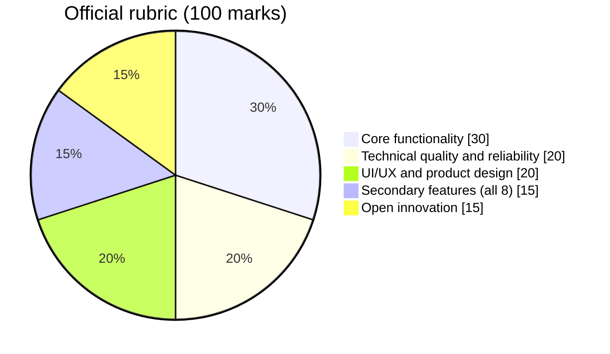
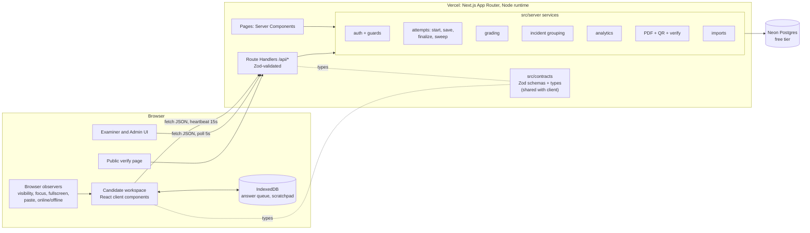
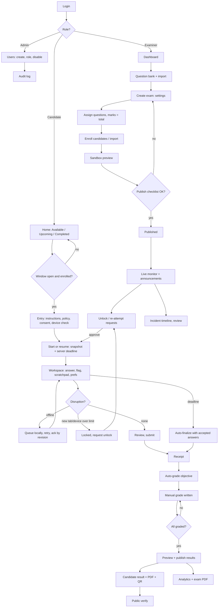
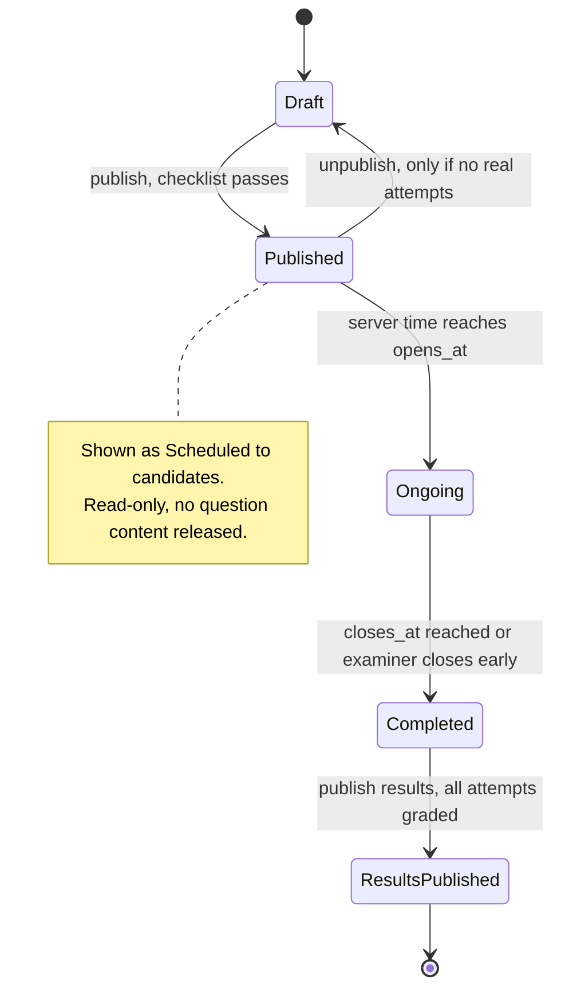
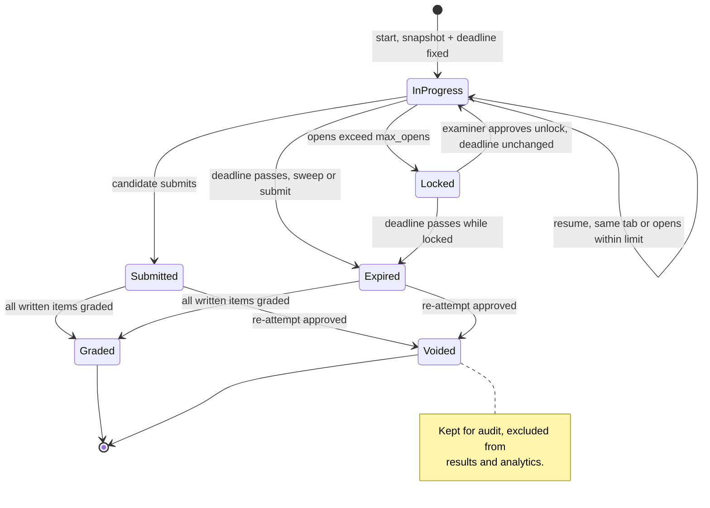
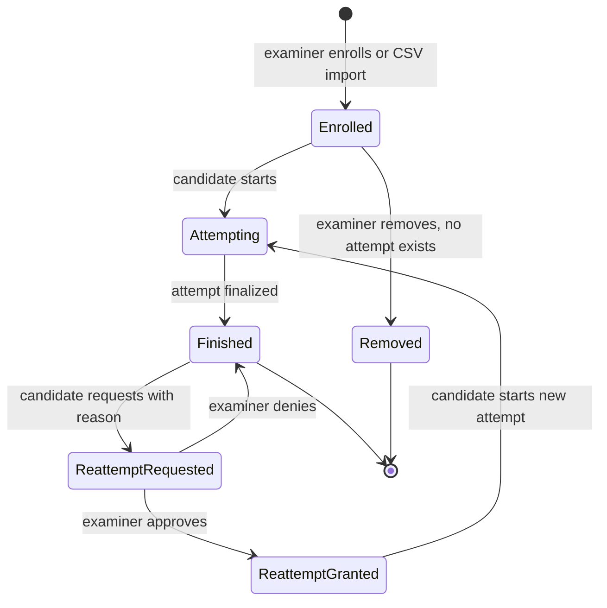
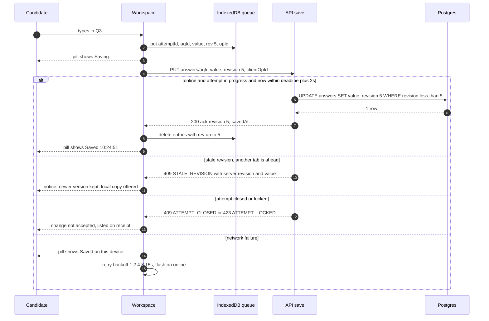
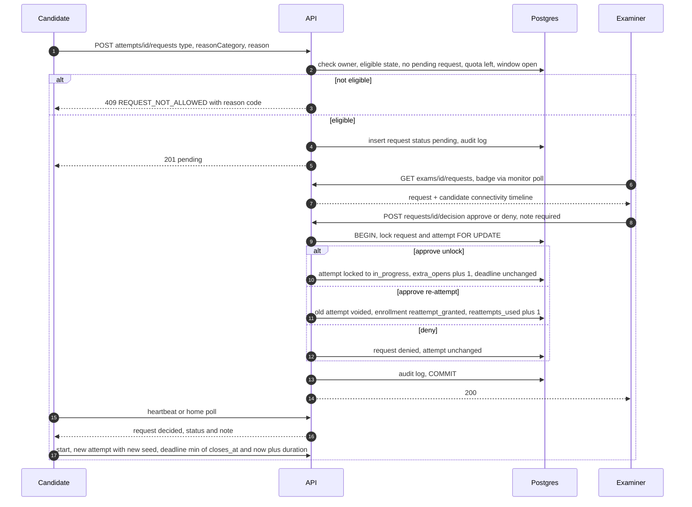
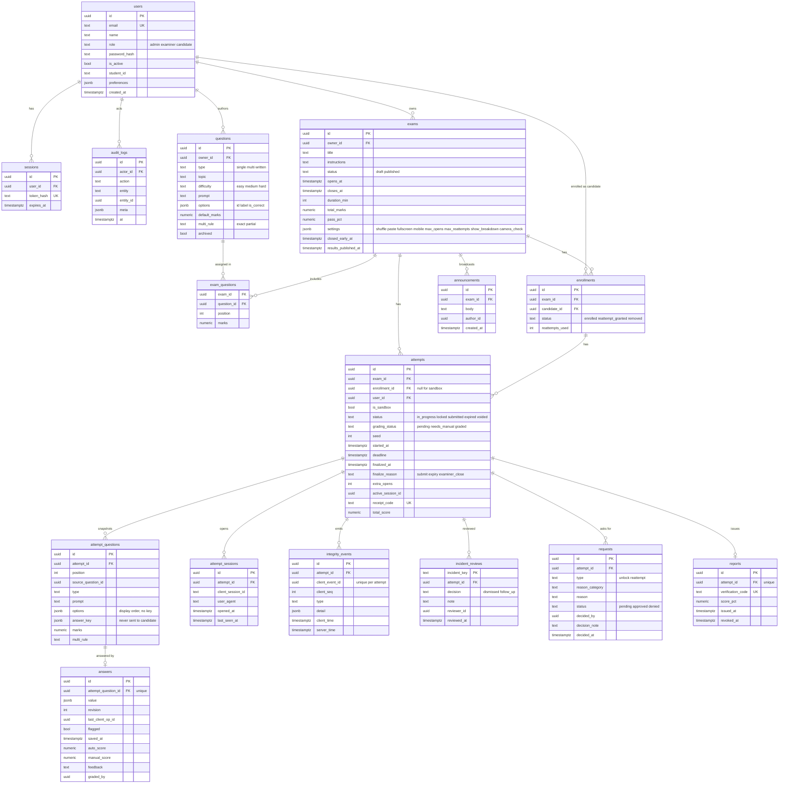

# Secure Examination Management System: PRD (single source of truth)

> **Status:** Final for build day, 27 Nov 2026 (Technoverse 5.0 Web-e-Thon, COMSATS Lahore).
> **Team:** Dev A (backend), Dev B (frontend).
> **Rule:** If code, a chat message or an AI agent disagrees with this file, this file wins. If this file disagrees with the official problem statement, the problem statement wins. Change this file by PR only, and tell the other dev.

## Contents

1. [Goal and how we score](#1-goal-and-how-we-score)
2. [Scope: roles, core, secondary, innovation](#2-scope)
3. [Architecture and tech choices](#3-architecture-and-tech-choices)
4. [End-to-end flow (43 steps)](#4-end-to-end-flow-43-steps)
5. [State diagrams](#5-state-diagrams)
6. [Key sequences](#6-key-sequences)
7. [Business rules BR-01 to BR-21](#7-business-rules-server-enforced)
8. [Integrity engine (innovation 5.1)](#8-integrity-engine-innovation-51)
9. [Failure resilience (innovation 5.3)](#9-failure-resilience-innovation-53)
10. [Data model](#10-data-model)
11. [Contracts (write these first)](#11-contracts-write-these-first)
12. [API list](#12-api-list)
13. [Page list](#13-page-list)
14. [Seed data and sample files](#14-seed-data-and-sample-files)
15. [Unclear requirements and our resolutions](#15-unclear-requirements-and-our-resolutions)
16. [Test matrix T01 to T30](#16-test-matrix-t01-to-t30)
17. [Team, branches and pull requests](#17-team-branches-and-pull-requests)
18. [Sprint plan](#18-sprint-plan)
19. [README checklist](#19-readme-checklist)
20. [Demo script (15 minutes)](#20-demo-script-15-minutes)
21. [What not to build](#21-what-not-to-build)
22. [AI tooling](#22-ai-tooling)

---

## 1. Goal and how we score

Ship one **deployed, complete exam journey** first: create, publish, take, submit, grade, publish results and view them. Then add the integrity engine and resilience features on top. Judges test common scenarios live, so every feature must hold up when a judge clicks it.



| Rubric area | Marks | What we show |
|---|---|---|
| Core functionality | 30 | Full journey with the reference exam, which scores 9/10 (§14). |
| Technical quality | 20 | Server-side timer, idempotent submit, ownership checks, revisioned saves, lazy expiry. |
| UI/UX | 20 | A candidate can always answer "Is my latest answer saved?" and "How long do I have?" without asking anyone. |
| Secondary features | 15 | All 8 features working inside the real flows, not as separate demo pages. |
| Innovation | 15 | **5.1** explainable incident timeline with human review. **5.3** offline queue, open limit, lock and strict re-attempt approval, with no extra time. |

**Philosophy:** prevent what we control, detect what we can observe, reduce the payoff of what we cannot control, and never punish what we cannot prove.

---

## 2. Scope

### 2.1 Roles

| Role | Can | Cannot |
|---|---|---|
| Administrator | Create, edit and disable users, assign roles, view all exams read-only, view audit log. | Grade, or take exams. |
| Examiner | Manage own question bank and own exams, enroll candidates (and import candidate accounts), preview in sandbox, publish, monitor, announce, decide unlock and re-attempt requests, review incidents, grade, publish results, view analytics and PDFs for own exams. | See or change other examiners' exams. |
| Candidate | See own enrolled exams, start or resume inside the window, answer, flag, use the scratchpad, set preferences, submit, request unlock or re-attempt, and view own published results, PDF and verification code. | See answer keys, other candidates' data, or unpublished results. |

### 2.2 Core requirements (problem statement §3) mapped to features

| § | Requirement | Our feature | Owner |
|---|---|---|---|
| 3.1 | Auth and authorization | DB sessions, role guard and ownership check in every handler (BR-01, BR-02) | A |
| 3.2 | Exam management and lifecycle | Exam builder, review-and-publish checklist, derived phase (BR-03) | A + B |
| 3.3 | Question bank, 3 types, randomization, snapshot | Bank with topic and difficulty. Single, multi and written types. Seeded shuffle. Attempt snapshot (BR-06, BR-07) | A + B |
| 3.4 | Candidate management | Enrollment and import. Candidate home split into Available, Upcoming and Completed. Entry checks (BR-04) | A + B |
| 3.5 | Exam interface | Workspace with navigator states, timer, autosave, review, submit and expiry (BR-05, BR-09, BR-10) | B + A |
| 3.6 | Monitoring | Live monitor, announcements, incident timeline, "indicators are not evidence" wording (BR-18) | B + A |
| 3.7 | Grading | Auto-grading (exact or partial multi-select), manual grading with limits (BR-14, BR-15) | A + B |
| 3.8 | Results and analytics | Controlled publish, own-results-only, exam and question analytics, retained attempts (BR-16) | A + B |

### 2.3 Secondary features (all 8 expected)

| § | Feature | Smallest complete version | Owner |
|---|---|---|---|
| 4.1 | Network-aware UI | Connection pill (Online / Offline / Server unreachable) and save pill (Saving… / Saved hh:mm:ss / Saved on this device / Not accepted), with acks matched by revision | B |
| 4.2 | PDF reports | Candidate result PDF and exam summary PDF from stored data, access-checked (pdf-lib) | A |
| 4.3 | Sandbox | "Preview as candidate" makes an `is_sandbox` attempt that is excluded from every count (BR-17) | A + B |
| 4.4 | Bulk import | CSV/JSON for questions and candidates. Dry run, then row and column errors, then an all-or-nothing commit (BR-20) | A + B |
| 4.5 | Question analytics | Correct rate, skip rate, most common wrong option, mean written score, observed difficulty, discrimination, and a "check key" flag | A + B |
| 4.6 | Verifiable reports | Random verification code and QR on the PDF. Public `/verify/{code}` shows masked info only (BR-19) | A |
| 4.7 | Workspace preferences | Text size, layout (single or split), navigator position, theme, reduced motion. Saved to the account | B |
| 4.8 | Scratchpad | Per-attempt notes panel that survives refresh and is never graded. Sketch canvas is a stretch goal | B |

### 2.4 Innovation challenges

- **Primary, 5.1 Integrity in the AI Era:** a browser-only, privacy-light **explainable integrity engine** (§8). Observations are grouped into incidents with plain-language explanations, a severity, and a human Dismiss or Follow-up decision. No automatic penalties, no recordings, no keystroke logging.
- **Secondary, 5.3 Failure-resilient exams:** an offline answer queue with server acknowledgment by revision, a server-fixed deadline, a session open limit with lock and unlock, and a strict re-attempt approval flow (§9). Disruptions never give the candidate extra time unless an examiner makes an audited decision.

---

## 3. Architecture and tech choices



| Concern | Choice | Why |
|---|---|---|
| Framework | **Next.js 16 (App Router) + TypeScript (strict)** | One repo, one deploy and one origin. Server Components for examiner pages, Route Handlers for the API. Both devs know React. |
| UI | **Tailwind CSS v4 + shadcn/ui + lucide-react** | Accessible primitives (Radix) we own and restyle, so it doesn't look like a template. The shadcn MCP lets agents pull components correctly. |
| Charts | **shadcn charts (Recharts)** | Free, themeable, fast to wire. |
| Database | **Postgres on Neon (free, via Vercel Marketplace, no card)** | Relational integrity, transactions, `SELECT … FOR UPDATE` for finalization. |
| ORM / migrations | **Drizzle ORM + drizzle-kit**, driver **node-postgres (`pg`)** with Neon's pooled URL | Typed SQL and real interactive transactions. Do **not** use the `neon-http` driver because it has no interactive transactions. |
| Validation and contracts | **Zod** in `src/contracts`, imported by handlers and client | Contracts first. The same schema validates on both sides (problem statement §6: validate on frontend and backend). |
| Auth | **Own DB sessions**: bcryptjs (cost 10), random 32-byte token in an httpOnly, Secure, SameSite=Lax cookie, SHA-256 of the token stored in `sessions` | Simple, server-revocable (disabling a user takes effect on the next request), no third-party service. |
| Realtime | **Polling**: monitor every 5s, workspace heartbeat every 15s | Reliable on Vercel serverless (no long-lived sockets). Good enough for a demo cohort. |
| Expiry | **Lazy sweep** on relevant requests + `finalizeAttempt` + optional daily Vercel cron | Vercel Hobby cron runs only daily, so correctness must not depend on it (BR-11). |
| Offline | **idb-keyval** (IndexedDB) queue + `online`/`offline` events + fetch failure detection | Answers survive refreshes and outages, and acks are per revision. |
| PDF / QR | **pdf-lib** + **qrcode** (MIT) | Pure JS, works in a serverless function, no headless browser. |
| CSV | **papaparse** | Robust parsing with row numbers for error messages. |
| Tests | **Vitest** (grading, grouping, rules), **Playwright** (E2E), plus the Playwright MCP for agent-driven checks | Covers T01–T30. |
| Hosting | **Vercel Hobby** + Neon free | No billing information required (problem statement §6). |

**Folder layout and ownership:**

```
src/
  app/                    # pages + route handlers       (pages: B, app/api: A)
    (auth)/login/
    admin/ examiner/ candidate/ exam/[attemptId]/ verify/
    api/**/route.ts
  contracts/              # Zod schemas + TS types        (A only)
  db/                     # schema.ts, client.ts, seed.ts (A only)
  server/                 # services, guards, sweep        (A)
  components/ui/          # shadcn primitives              (B)
  components/{exam,examiner,admin,charts,common}/          (B)
  lib/client/             # api client, offline queue, observers (B)
  mocks/                  # mock responses typed by contracts    (B)
drizzle/                  # generated migrations          (A only)
samples/                  # import templates + invalid examples (A)
tests/unit/ tests/e2e/    # A: unit and API, B: e2e UI
```

---

## 4. End-to-end flow (43 steps)



Edge cases are written inline. **Bold** marks the server rule that enforces each step.

**A. Admin setup**
1. Admin signs in and lands on `/admin`. Wrong password shows a generic error. After 5 failures in 5 minutes for that email, login is refused for 5 minutes. **BR-21**
2. Admin creates examiner and candidate accounts with a temporary password. A duplicate email gets a 409 with "Email already in use". **BR-20**
3. Admin changes a role or disables an account. Disabling deletes all of that user's sessions, so their next request returns 401 and they are sent to login. Admin cannot disable themself. **BR-02**

**B. Examiner authoring**
4. Examiner signs in and lands on `/examiner`, which shows cards for Drafts, Scheduled, Live now, Awaiting grading, Ready to publish, and Pending requests.
5. Creates questions: type (single, multi, written), topic, difficulty (easy, medium, hard), prompt, options, correct key, default marks, multi-select rule (exact or partial). Validation: a single-answer question has exactly 1 correct option. A multi-select question has at least 1 correct and at least 2 options. A written question has no options. Marks are between 0.5 and 100 in steps of 0.5.
6. Imports questions from CSV or JSON. The dry run shows every bad row with its row number, column and reason. Commit happens only when there are zero errors, and the whole file commits in one transaction. **BR-20**
7. Creates an exam draft: title, instructions, opens at, closes at, duration in minutes, total marks, pass mark %, shuffle questions, shuffle options, paste policy (allow / block / allow and log), fullscreen required, allow mobile, max opens (default 3), max re-attempts (default 1), show breakdown to candidates. Validation: opens < closes, and duration ≤ the window length.
8. Assigns questions from the bank and sets order and per-exam marks. A live indicator shows "Assigned 10 / 10 marks", green when it matches.
9. Enrolls existing candidates by search, or imports a candidate CSV (`name,email,student_id`), which creates any missing candidate accounts and enrolls them. Re-enrolling the same person does nothing (unique key). An enrollment can be removed only if no attempt exists.
10. Clicks **Preview as candidate**. This opens the real workspace with a "Sandbox preview: nothing is recorded" banner. The sandbox attempt is excluded everywhere and deleted on exit. **BR-17**
11. Opens **Review & publish**. A checklist covers: at least 1 question, marks sum equals the total, valid window, instructions present, at least 1 candidate enrolled (warning only). If all pass, the exam moves to published (shown as "Scheduled" until it opens). **BR-03**
12. Edge case: once the exam is published, settings and questions are read-only. Unpublish (back to draft) is allowed only while no real attempt exists. **BR-03**

**C. Candidate before the exam**
13. Candidate signs in and lands on `/candidate`, which has three tabs: Available, Upcoming, Completed. Each card shows the window, duration, marks and status ("Not started", "In progress, 12 min left", "Submitted, results pending", "Results published", "Locked, waiting for examiner").
14. Upcoming exam: a countdown, and a disabled Start button. Calling the start API directly returns 403 `EXAM_NOT_OPEN`. No question content is released before start. **BR-04**
15. When server time reaches opens at, the card moves to Available on the next poll (60s on home). The client clock is never trusted. **BR-05**
16. Entry page shows the instructions, total marks, duration, number of questions, marking rules (including the multi-select rule), monitoring notice (what is observed and what is not), paste policy, what happens offline, and the open limit. The candidate must tick a consent box before starting.
17. Device check: online, fullscreen supported (if required), and mobile policy. If mobile is not allowed and a coarse pointer with a width under 768px is detected, the candidate sees "This exam must be taken on a laptop or desktop". This is a client check, documented as best effort.

**D. Attempt**
18. Start calls `POST /api/exams/{id}/attempts`. The server checks eligibility, then either returns the existing attempt or creates one with a seed, a snapshot of the questions, options, keys and marks, and `deadline = min(closes_at, now + duration)`. It returns the questions **without keys**, plus `serverNow`. **BR-04 BR-05 BR-06 BR-07 BR-08**
19. If fullscreen is required, the client requests it. If the request is denied or fullscreen is exited, the questions are hidden behind a "Return to fullscreen" panel. The answers and timer keep going, and an observation is logged. **BR-18**
20. The workspace shows: question n of N, marks, type hint, timer (server offset), connection pill, save pill, and a navigator whose states are Answered, Not answered, Flagged and Not synced. Each state uses both an icon and text, not colour alone.
21. On each edit, the client writes to IndexedDB, then sends a debounced save (800 ms) with `{value, revision, clientOpId}`. The ack carries the accepted revision, and the save pill shows "Saved 10:24:51" only when ack.revision equals the latest local revision. **BR-09**
22. Flag or unflag for review. This is saved to the server and does not change the revision.
23. Scratchpad panel: plain-text notes per attempt, stored in IndexedDB and restored on refresh, never sent for grading. Preferences (text size, layout, navigator position, theme) are saved to the account and applied immediately.
24. Heartbeat every 15s returns `serverNow`, `deadline`, `status` and any new announcements, which appear as a dismissible banner with aria-live polite. A missed heartbeat feeds the connectivity view on the monitor only.
25. Refresh in the same tab resumes the same attempt with the same deadline and does **not** count as a new open, because the `clientSessionId` is kept in sessionStorage. Server answers are merged with any newer local pending revisions, which are then re-sent.
26. Opening in a new tab or device creates a new open. The newest session becomes active. The old tab shows "This exam is active in another window" with a "Use this window" button, which counts as another open. A save from a superseded session gets 409 `SESSION_SUPERSEDED`. **BR-12**
27. When opens exceed the limit, the attempt becomes **Locked**: saves get 423, and the candidate sees a lock screen with "Request unlock" (a reason is required). **The timer keeps running.** If the deadline passes while locked, the attempt is finalized with the answers already accepted. **BR-12 BR-13**
28. Network loss shows "Offline: answers are saved on this device". The queue retries with backoff (1, 2, 4, 8, max 15 s) and flushes on `online`. A stale-revision 409 keeps the newer server value and shows a notice. The candidate can keep working.
29. Browser observations (hidden/visible, blur/focus, fullscreen exit/enter, paste with outcome and character count, copy blocked, resize, offline/online) are batched every 10s, and sent with `sendBeacon` on pagehide, to `/events` with a client sequence number and a UUID. **No clipboard contents and no keystrokes are recorded.** **BR-18**
30. Timer warnings at 5 minutes and 1 minute (aria-live, non-blocking). Under 1 minute, the timer turns to the warning style with a text label.
31. The review screen shows Answered, Not answered, Flagged and Not synced counts, with links to jump to each item.
32. Submit flushes the queue, then shows a confirm dialog that lists any unsynced items. On confirm it calls `POST /submit`, which finalizes in one transaction, auto-grades objective items, and returns a receipt: reference, server time, and "Results pending". A double click or a second tab gets the **same** receipt. **BR-10**
33. Deadline reached in the browser: the workspace locks its inputs and calls submit. The server finalizes with the answers accepted up to `deadline + 2 s grace`. Later saves get 409 `ATTEMPT_CLOSED`, and the UI lists "Changes not accepted (made after the deadline or while offline)". **BR-09 BR-10**
34. Browser closed and never returned: the next request that touches the exam (candidate home, examiner monitor, grading, results) runs the sweep and finalizes it as **Expired**. **BR-11**

**E. Monitoring**
35. Examiner opens **Live monitor** (polls every 5s). For each candidate it shows: status, progress (answered of total), last contact ("12s ago"), opens used of the limit, connection state, and incident counts by severity. Header totals cover Not started, In progress, Locked, Submitted and Expired. Filter by status or severity.
36. Sends an announcement (1–500 chars). Candidates receive it on their next heartbeat. A candidate who joins late gets all earlier announcements for the exam.
37. Opens a candidate's **incident timeline**: grouped incidents, each with its raw observations, timings, an explanation and a severity. The examiner can Dismiss or Request follow-up and add a note. The page always shows the banner "Observations are not proof of misconduct", and a review decision never changes marks. **BR-18**
38. **Requests** tab: unlock and re-attempt requests, with the candidate's reason and their connectivity timeline. Approve or Deny requires a note, and every decision is audited. **BR-13**

**F. Grading, results and analytics**
39. Objective items are auto-graded at finalization. The **grading queue** lists written answers by question or by candidate, showing the submitted answer, max marks and any feedback.
40. Examiner enters a score between 0 and max (steps of 0.5) plus optional feedback. The server rejects anything outside range (422), recomputes the total, and marks the attempt Graded once no written item is pending. Saving the same grade twice has no further effect. **BR-15**
41. **Results preview** shows every real attempt with its total, % and pass/fail. Publishing is blocked while any attempt is still in progress or any grade is missing. Publishing sets `results_published_at` and issues reports, each with a verification code. **BR-16 BR-19**
42. Candidate's Completed tab shows "Results published". The result page shows the total, %, pass/fail, per-question breakdown (if the exam allows) and feedback. **Download PDF** produces the same numbers, plus the verification code and a QR. Another candidate gets 404. **BR-01 BR-16**
43. Anyone can open `/verify/{code}` (or scan the QR) and see Valid, the exam title, masked candidate name ("A. K***"), the issue date and the score. An unknown code shows a neutral "No report found for this code". The examiner's **Analytics** page shows the score distribution, mean, median, min, max, pass rate and completion rate, plus question analytics and an exam summary PDF. **BR-19**

---

## 5. State diagrams

### 5.1 Exam

Stored: `status ∈ {draft, published}`, `closed_early_at`, `results_published_at`. The **phase** shown in the UI is derived from server time (BR-03).



### 5.2 Attempt

`status ∈ {in_progress, locked, submitted, expired, voided}` and `grading_status ∈ {pending, needs_manual, graded}`.



### 5.3 Enrollment



---

## 6. Key sequences

### 6.1 Answer save path (BR-09)



### 6.2 Strict re-attempt / unlock approval (BR-12, BR-13)



---

## 7. Business rules (server-enforced)

Every rule lives in `src/server`, not just in the UI. Each rule names its tests.

| ID | Rule | Tests |
|---|---|---|
| **BR-01** | Every `/api` handler calls `requireUser(role)` and then an ownership check: the examiner owns the exam, the candidate owns the attempt or enrollment, and admin is read-only on exams. A resource the caller doesn't own returns **404** (not 403) so its existence is not leaked. A wrong role returns 403. | T02 T03 T04 |
| **BR-02** | Sessions are stored server-side. A disabled user has all sessions deleted, and `requireUser` also checks `users.is_active` on every request. The session lasts 12h, sliding. | T05 |
| **BR-03** | Exam phase is derived: `draft` while status is draft. After publishing: `scheduled` if now < opens, `ongoing` if opens ≤ now < closes and not closed early, otherwise `completed`, and `results_published` once results are published. Publishing requires the checklist (§4 step 11). Published exams are immutable. Unpublish only if no real attempt exists. | T06 |
| **BR-04** | Start or resume requires: user active, role candidate (or examiner owner with `sandbox=true`), enrollment exists and is not removed, phase `ongoing`, no finalized non-voided attempt unless a re-attempt was granted, attempt not locked. Each failure returns its own error code. | T07 T08 T09 |
| **BR-05** | `deadline = min(closes_at, started_at + duration)` is stored once at creation. All time checks use DB/server `now()`. Every attempt response includes `serverNow`. Nothing extends a deadline in v1. | T09 T13 |
| **BR-06** | At start, `attempt_questions` copies the prompt, options (in display order), key, marks and multi-select rule. Grading and display use only the snapshot. Editing or archiving a source question never changes a started attempt. | T10 |
| **BR-07** | Randomization uses a per-attempt `seed` (stored) with a seeded shuffle of question order and option order when enabled. Start is idempotent, so the same attempt returns the same order. | T09 T21 |
| **BR-08** | Candidate DTOs are built by whitelist mappers in `src/server/mappers`. `key`, `is_correct`, other candidates' data and examiner notes never appear in candidate responses before results are published. Even after publishing, the correct key is shown only if `show_breakdown` is on. | T11 |
| **BR-09** | A save is accepted only if: the session is the active one, attempt status is `in_progress`, `server_now ≤ deadline + 2s`, and `revision > stored revision`. It is idempotent on `clientOpId`. The response acks the stored revision. A stale write returns 409 with the current server revision. | T14 T15 T16 T17 |
| **BR-10** | One function, `finalizeAttempt(attemptId, reason)`, used by submit, sweep and examiner close. It runs `BEGIN; SELECT … FOR UPDATE`. If the attempt is already final it returns the existing receipt. Otherwise it sets status, `finalized_at`, the auto scores, `grading_status` and the receipt code, then commits. There is a unique receipt per attempt. | T18 T19 |
| **BR-11** | Lazy sweep: `sweepExpired(examId?)` finalizes attempts where `deadline < now()` and status is `in_progress` or `locked`. It runs at the start of: candidate home, workspace GET and heartbeat, monitor, grading, results and analytics. The daily cron is a backup only. | T19 |
| **BR-12** | Opens are counted as distinct `clientSessionId`s per attempt (a same-tab refresh is free). The newest session is active, and older sessions are superseded. If `opens > max_opens + extra_opens`, status becomes `locked`. While locked, saves and events are refused (423) and the clock keeps running. | T20 |
| **BR-13** | Requests: types `unlock` and `reattempt`. One pending request per attempt. A reason is required (10–500 chars, plus a category: connectivity, device, power, other). `reattempt` is only allowed while the attempt is final, the exam phase is `ongoing`, results are unpublished, and `reattempts_used < max_reattempts`. A decision requires the exam owner and a note. Approving a re-attempt voids the old attempt and allows one new attempt with a new seed. Everything is audited. | T20 T21 |
| **BR-14** | Auto-grading. Single: full marks if the chosen option equals the key, otherwise 0. Multi **exact** (default): full marks only if the selected set equals the key set exactly. Multi **partial**: `marks × max(0, (correctSelected − wrongSelected) / keyCount)`, rounded to 0.01. An empty answer scores 0 and counts as skipped. No negative totals. | T22 |
| **BR-15** | Manual grade: `0 ≤ score ≤ max`, a multiple of 0.5, only on a finalized non-voided attempt of the examiner's own exam, and only before results are published (after that, a grade change requires unpublish, which is v2). The total is always recomputed in SQL from the parts. Upserts are idempotent. | T23 |
| **BR-16** | Results publish requires no attempt `in_progress` or `locked` (after the sweep) and every non-voided attempt `graded`. Before publishing, candidates see "Results pending" only. After publishing, a candidate sees only their own result. | T24 |
| **BR-17** | Sandbox attempts have `is_sandbox = true`, are owned by the examiner, and need no enrollment. Every query for counts, monitor, grading, results, analytics or reports goes through `realAttempts()`, which filters `is_sandbox = false AND status <> 'voided'`. Leaving the sandbox deletes its rows. | T26 |
| **BR-18** | Integrity events are untrusted hints. They are accepted only for the active session of an `in_progress` attempt, deduplicated on `(attempt_id, client_event_id)`, and stored with `client_seq`, `client_time` and `server_time`. Maximum 200 events per batch and 2,000 per attempt. They **never** change scores, status or time. Incidents are derived (§8). Review decisions are stored separately. | T28 T29 |
| **BR-19** | Reports are issued at results publish, one per graded attempt, each with a random 10-character base32 code (unique). PDF access: the candidate owner after publish, the exam owner, or an admin. Public verify returns only: valid, exam title, masked name, issue date, score %, and whether it was revoked. Unknown codes return the same neutral shape. | T25 |
| **BR-20** | Imports: at most 1 MB / 1,000 rows, UTF-8 CSV or JSON. Each row is validated with the same Zod schema as the create endpoint. Duplicates are checked within the file and against the DB. `dryRun=true` returns `{valid, errors:[{row, column, message}]}`. Commit re-validates and inserts in a single transaction, all or nothing. | T27 |
| **BR-21** | Zod on every input, with 422 and field errors on failure. Login is throttled (5 failures per email per 5 min, tracked in the DB). For every non-GET `/api` request, `Origin` must equal `APP_URL` (CSRF). Passwords are bcrypt hashed. Security headers are set in `next.config`. Admin, grading, publishing and request decisions write to `audit_logs`. | T01 T05 |

**Error shape (all endpoints):** `{ "error": { "code": "ATTEMPT_CLOSED", "message": "Human readable", "fields"?: { "path": "msg" } } }`

Codes: `UNAUTHENTICATED` 401, `FORBIDDEN` 403, `NOT_FOUND` 404, `VALIDATION` 422, `EXAM_NOT_OPEN` 403, `EXAM_CLOSED` 403, `NOT_ENROLLED` 403 (returned as 404 when probing someone else's exam), `ALREADY_SUBMITTED` 409, `ATTEMPT_CLOSED` 409, `ATTEMPT_LOCKED` 423, `SESSION_SUPERSEDED` 409, `STALE_REVISION` 409, `REQUEST_NOT_ALLOWED` 409, `PUBLISH_BLOCKED` 409, `RATE_LIMITED` 429.

---

## 8. Integrity engine (innovation 5.1)

**Principle:** observe only inside the exam tab, only during an active attempt, and only what the candidate was told about at entry. Group the observations, explain them, and let a human decide.

**Observations collected** (`integrity_events.type`): `visibility_hidden`, `visibility_visible`, `window_blur`, `window_focus`, `fullscreen_exit`, `fullscreen_enter`, `paste` (detail: `{aqId, chars, outcome: allowed|blocked}`), `copy_blocked`, `resize` (`{w,h}`), `offline`, `online`, `mobile_detected`, plus server-derived `session_opened`, `session_superseded` and `heartbeat_gap`.
**Never collected:** clipboard text, keystrokes, screenshots, camera frames, URLs of other tabs.

**Grouping algorithm** (`src/server/incidents/group.ts`, pure function, unit-tested; incidents are recomputed on read from events, so they are deterministic):

1. Sort events by `client_seq` (ties broken by `server_time`). Events that arrived late are kept in their observed position, and the timeline shows "received 40 s later" when `server_time − client_time > 10 s`.
2. **Away interval:** opened by the first of `visibility_hidden`, `window_blur` or `fullscreen_exit`. Any further away-type event within the interval is merged in. The interval is closed by `visibility_visible` / `window_focus` / `fullscreen_enter` once all opened signals have returned. If it never closes: "end unknown".
3. **Related paste:** a `paste` of ≥ 50 chars within **10 s** after an away interval closes is attached to that interval (the gap is recorded, e.g. "2 s after returning").
4. **Connectivity incidents** (`offline`/`online` and `heartbeat_gap`) are a **separate category**. They are never merged with away intervals and never above Info.
5. **Severity:**

| Pattern | Severity |
|---|---|
| Blur only, < 5 s, or resize | Info |
| Hidden or fullscreen exit ≥ 5 s | Review |
| Large paste (≥ 200 chars) alone, when allowed by policy | Review |
| Away ≥ 5 s, then a related paste (allowed or blocked) | **Priority review** |
| ≥ 3 Review incidents in 10 min | Priority review (with a "repeated" reason) |
| Any connectivity incident | Info (category: connectivity) |

6. **Explanation text** is generated from the facts, never accusatory. For example: *"The exam page was hidden for 45 s (10:24:02–10:24:47). 2 s after returning to Question 3, a 348-character paste was attempted and blocked by the exam policy. What happened while the page was hidden is unknown."*
7. **Incident key** = `attemptId:firstEventId`, which is stable across recomputes. `incident_reviews(incident_key, decision: dismissed|follow_up, note, reviewer_id, reviewed_at)`.

**Trade-offs we explain to judges:** browser events can be spoofed or missed, so they are hints. We deliberately trade detection power for privacy and fairness, and correctness is guaranteed server-side (time, keys, grading) regardless.

**Optional (Dev B, last, cut first): camera presence check.** Off by default (`camera_check` setting). On the entry page the candidate sees a local preview. During the exam, an on-device face count runs every 5 s using MediaPipe Face Detector (WASM, Apache-2.0, assets self-hosted). Only `face_absent_10s` or `multiple_faces` events are sent. No image ever leaves the device. If the camera is denied, an observation is logged and the candidate continues.

---

## 9. Failure resilience (innovation 5.3)

| Disruption | What happens | Why it is fair |
|---|---|---|
| Wi-Fi drops while typing | Answers go to the IndexedDB queue and the pill reads "Saved on this device". Retries on reconnect. Acks are matched per revision. | The server accepts only before `deadline + 2s`. |
| Server unreachable, Wi-Fi up | Same as above: fetch failures are treated as offline, and `navigator.onLine` is only a hint. | Same. |
| Refresh or crash in the same tab | Resume: server answers merged with newer local revisions, same deadline, no open counted. | The deadline is stored server-side. |
| Laptop dies, candidate moves to another device | A new open (counted). Server-accepted answers load. Local-only edits from the dead device are lost, and the UI says so honestly. | Open limit stops device-hopping abuse. |
| Too many opens | Locked, request unlock, examiner decides with the connectivity timeline in view. | The clock keeps running, so there is no time gain. |
| Long outage, attempt expired | The candidate can request a **re-attempt** (strict: reason, quota, window open, examiner note, audited). | The decision is made by a human with evidence. The voided attempt is kept. |
| Offline past the deadline | Pending changes are listed as "not accepted" on the receipt. Finalized from accepted answers. | A device timestamp cannot prove when an edit was made. |

**Limits stated in the README:** reloading the page while fully offline needs the page to load again (no service worker in v1). Local drafts are scoped to the account and attempt, and cleared after a confirmed submit.

---

## 10. Data model

All ids are `uuid` (`gen_random_uuid()`), all times are `timestamptz` UTC, enums are `text` with CHECK constraints, and every FK has an index.



Key constraints: `unique(exam_id, candidate_id)` on enrollments. A partial unique index on attempts, `(enrollment_id) WHERE status IN ('in_progress','locked') AND NOT is_sandbox`, so there is never more than one live attempt. `unique(attempt_id, client_event_id)` on events. `unique(attempt_id, client_session_id)` on sessions. Also `login_failures(email, at)` for throttling (not shown).

---

## 11. Contracts (write these first)

Dev A writes `src/contracts/*.ts` in Sprint 0 (by 12:45) and merges it first. Dev B builds against `src/mocks/*` typed by these. **Changing a contract needs a PR labelled `contract` that both devs approve.**

```ts
// src/contracts/attempt.ts (abridged; real file uses Zod, types via z.infer)
export type QuestionType = 'single' | 'multi' | 'written';

export interface CandidateQuestion {           // never contains a key
  aqId: string; position: number; type: QuestionType;
  prompt: string; marks: number;
  options?: { id: string; label: string }[];   // display order
  multiRule?: 'exact' | 'partial';
}
export interface SavedAnswer { aqId: string; value: AnswerValue | null; revision: number; flagged: boolean; savedAt: string | null }
export type AnswerValue = { optionIds: string[] } | { text: string };   // single uses optionIds of length 1

export interface AttemptPolicy { pastePolicy: 'allow' | 'block' | 'log'; fullscreenRequired: boolean; allowMobile: boolean; maxOpens: number; opensUsed: number; cameraCheck: 'off' | 'presence' }

export interface StartAttemptRequest { clientSessionId: string; sandbox?: boolean }
export interface AttemptState {                 // returned by start, GET attempt
  attemptId: string; examId: string; examTitle: string; isSandbox: boolean;
  status: 'in_progress' | 'locked' | 'submitted' | 'expired' | 'voided';
  serverNow: string; deadline: string;          // ISO, server clock
  questions: CandidateQuestion[]; answers: SavedAnswer[]; policy: AttemptPolicy;
  announcements: { id: string; body: string; createdAt: string }[];
  activeSession: boolean;                       // false => superseded
  pendingRequest?: { id: string; type: 'unlock' | 'reattempt'; status: 'pending' | 'approved' | 'denied' } | null;
}

export interface SaveAnswerRequest { value: AnswerValue | null; revision: number; clientOpId: string; clientSessionId: string }
export interface SaveAnswerAck { aqId: string; revision: number; savedAt: string }       // revision = stored revision

export interface HeartbeatRequest { clientSessionId: string; answeredCount: number }
export interface HeartbeatResponse { serverNow: string; deadline: string; status: AttemptState['status']; activeSession: boolean; announcements: AttemptState['announcements']; pendingRequest: AttemptState['pendingRequest'] }

export interface IntegrityEventIn { clientEventId: string; clientSeq: number; type: string; clientTime: string; detail?: Record<string, unknown> }
export interface EventsBatchRequest { clientSessionId: string; events: IntegrityEventIn[] }   // max 200

export interface SubmitRequest { clientSessionId: string }
export interface SubmissionReceipt {
  attemptId: string; receiptCode: string; finalizedAt: string;
  reason: 'submit' | 'expiry' | 'examiner_close';
  acceptedCount: number; unansweredCount: number;
  resultsStatus: 'pending' | 'published';
}
```

```ts
// src/contracts/incident.ts
export interface IncidentDTO {
  key: string; attemptId: string;
  category: 'away' | 'paste' | 'connectivity' | 'session' | 'camera';
  severity: 'info' | 'review' | 'priority';
  startedAt: string; endedAt: string | null;     // null => "end unknown"
  durationSec: number | null; questionPosition?: number;
  explanation: string; groupingReason: string;
  observations: { type: string; clientTime: string; serverTime: string; detail?: Record<string, unknown> }[];
  review: { decision: 'dismissed' | 'follow_up'; note: string; reviewer: string; reviewedAt: string } | null;
}
```

Other contract files: `auth.ts`, `user.ts`, `question.ts`, `exam.ts` (ExamDTO with derived `phase`), `enrollment.ts`, `monitor.ts` (MonitorRow), `grading.ts`, `results.ts`, `analytics.ts`, `request.ts`, `import.ts`, `errors.ts`.

---

## 12. API list

All JSON responses, except PDFs. Auth column: `A` admin, `E` examiner (owner), `C` candidate (owner), `P` public. Every handler follows the same pattern: `sweep (if listed) → requireUser → zod.parse → ownership → service → mapper`.

| # | Method and path | Auth | Purpose | BR |
|---|---|---|---|---|
| 1 | `POST /api/auth/login` | P | email + password → session cookie | 21 |
| 2 | `POST /api/auth/logout` | any | delete session | |
| 3 | `GET /api/auth/me` | any | current user + role + preferences | 02 |
| 4 | `GET /api/admin/users` | A | list/filter users | 01 |
| 5 | `POST /api/admin/users` | A | create user with temp password | 20 |
| 6 | `PATCH /api/admin/users/{id}` | A | name, role, is_active, reset password | 02 |
| 7 | `GET /api/admin/audit` | A | audit log, paginated | 21 |
| 8 | `GET /api/questions` | E | own bank, filter topic/difficulty/type/search | 01 |
| 9 | `POST /api/questions` | E | create question | 06 |
| 10 | `PATCH /api/questions/{id}` | E | edit, or archive with `{archived:true}` | 06 |
| 11 | `POST /api/questions/import?dryRun=` | E | CSV/JSON import | 20 |
| 12 | `GET /api/exams` | E A | own exams (admin: all) with phase + counts | 03 |
| 13 | `POST /api/exams` | E | create draft | 03 |
| 14 | `GET /api/exams/{id}` | E A | detail + checklist | 03 |
| 15 | `PATCH /api/exams/{id}` | E | edit draft settings | 03 |
| 16 | `PUT /api/exams/{id}/questions` | E | set assigned questions, order, marks | 03 |
| 17 | `POST /api/exams/{id}/publish` | E | validate checklist and publish | 03 |
| 18 | `POST /api/exams/{id}/unpublish` | E | back to draft if no attempts | 03 |
| 19 | `POST /api/exams/{id}/close` | E | close early, finalize all live attempts | 10 |
| 20 | `GET /api/exams/{id}/enrollments` | E | list with attempt status | 01 |
| 21 | `POST /api/exams/{id}/enrollments?dryRun=` | E | enroll by ids/emails, or CSV import | 20 |
| 22 | `DELETE /api/enrollments/{id}` | E | remove if no attempt | |
| 23 | `GET /api/me/exams` | C | available / upcoming / completed (sweeps) | 04 11 |
| 24 | `GET /api/me/exams/{examId}` | C | entry info: instructions, policy, access status | 04 |
| 25 | `GET /api/me/preferences` · `PUT` | C | workspace preferences | |
| 26 | `POST /api/exams/{id}/attempts` | C E(sandbox) | start or resume → `AttemptState` | 04–07 12 17 |
| 27 | `GET /api/attempts/{id}` | C E(sandbox) | full state for resume (sweeps) | 08 11 |
| 28 | `PUT /api/attempts/{id}/answers/{aqId}` | C | save with revision → `SaveAnswerAck` | 09 |
| 29 | `PUT /api/attempts/{id}/flags/{aqId}` | C | flag/unflag | 09 |
| 30 | `POST /api/attempts/{id}/heartbeat` | C | serverNow, status, announcements | 05 11 |
| 31 | `POST /api/attempts/{id}/events` | C | batch integrity observations | 18 |
| 32 | `POST /api/attempts/{id}/submit` | C | finalize → `SubmissionReceipt` (idempotent) | 10 |
| 33 | `DELETE /api/attempts/{id}` | E | discard sandbox attempt only | 17 |
| 34 | `POST /api/attempts/{id}/requests` | C | request unlock / re-attempt | 13 |
| 35 | `GET /api/exams/{id}/requests` | E | pending + decided requests | 13 |
| 36 | `POST /api/requests/{id}/decision` | E | approve/deny with note | 13 |
| 37 | `GET /api/exams/{id}/monitor` | E | live rows + totals (sweeps) | 11 18 |
| 38 | `POST /api/exams/{id}/announcements` | E | broadcast | |
| 39 | `GET /api/attempts/{id}/incidents` | E | grouped incident timeline | 18 |
| 40 | `PUT /api/attempts/{id}/incidents/{key}/review` | E | dismiss / follow-up + note | 18 |
| 41 | `GET /api/exams/{id}/grading` | E | written-answer queue (sweeps) | 15 |
| 42 | `PUT /api/attempts/{id}/grades/{aqId}` | E | manual score + feedback | 15 |
| 43 | `GET /api/exams/{id}/results` | E | preview table + blockers | 16 |
| 44 | `POST /api/exams/{id}/results/publish` | E | publish + issue reports | 16 19 |
| 45 | `GET /api/me/results/{attemptId}` | C | own published result | 16 |
| 46 | `GET /api/attempts/{id}/report.pdf` | C E A | candidate result PDF | 19 |
| 47 | `GET /api/exams/{id}/report.pdf` | E A | exam summary PDF | 19 |
| 48 | `GET /api/verify/{code}` | P | masked verification result | 19 |
| 49 | `GET /api/exams/{id}/analytics` | E A | exam + question analytics | 17 |

---

## 13. Page list

| Route | Who | Content | Owner |
|---|---|---|---|
| `/login` | all | Email + password, role redirect, demo credentials hint (non-production flag) | B |
| `/admin` | A | Users table: search, create, role, disable/enable, reset password | B |
| `/admin/audit` | A | Audit log | B |
| `/examiner` | E | Dashboard cards (step 4) + exam list with phase badges | B |
| `/examiner/questions` | E | Bank table, filters, create/edit drawer, archive | B |
| `/examiner/questions/import` | E | Upload, dry-run errors table, commit | B |
| `/examiner/exams/new` | E | Create form | B |
| `/examiner/exams/[id]` | E | Tabs: **Setup · Questions · Candidates · Review & publish** + "Preview as candidate" | B |
| `/examiner/exams/[id]/monitor` | E | Live table, totals, announcements composer, requests badge | B |
| `/examiner/exams/[id]/attempts/[attemptId]` | E | Incident timeline + answers + session/opens history | B |
| `/examiner/exams/[id]/requests` | E | Unlock / re-attempt queue with decision dialog | B |
| `/examiner/exams/[id]/grading` | E | Queue by question or candidate, score + feedback, keyboard next | B |
| `/examiner/exams/[id]/results` | E | Preview table, blockers, publish, PDF | B |
| `/examiner/exams/[id]/analytics` | E | KPIs, histogram, question table with flags, exam PDF | B |
| `/candidate` | C | Tabs: Available / Upcoming / Completed | B |
| `/candidate/exams/[examId]` | C | Entry: instructions, rules, monitoring notice, consent, device check, Start/Resume | B |
| `/exam/[attemptId]` | C, E(sandbox) | **Workspace**: top bar (title, timer, connection, save), navigator, question, scratchpad + prefs panel, announcements, lock/superseded overlays | B |
| `/exam/[attemptId]/review` | C | Counts + jump links + submit | B |
| `/exam/[attemptId]/receipt` | C | Receipt, not-accepted changes list, "Request re-attempt" (if allowed) | B |
| `/candidate/results/[attemptId]` | C | Score, breakdown, feedback, PDF, verification code | B |
| `/candidate/settings` | C | Preferences | B |
| `/verify` and `/verify/[code]` | P | Code input; masked result | B |

**Design direction (Dev B):** calm and paper-like, with high contrast. Use one accent colour, and pair every status colour with an icon and text. Use a mono font for the timer and codes. The workspace has three zones: navigator (left, collapsible; bottom sheet on mobile), question (centre, max 72ch), and tools rail (right: scratchpad and preferences). Visible focus rings, works at 200% zoom, at least 44px touch targets. Use the `frontend-design` skill so it doesn't look like a template.

---

## 14. Seed data and sample files

`pnpm db:seed` is idempotent (it truncates and reseeds). Times are relative to now, so the demo always works. **All demo passwords: `Demo@2026`**. All emails use the reserved `.test` domain, and all people are fictional.

| Email | Role | Purpose |
|---|---|---|
| `admin@exam.test` | Admin | User management |
| `examiner@exam.test` | Examiner | Owns exams 1–4 |
| `examiner2@exam.test` | Examiner | Owns exam 5 (authorization test T04) |
| `ali@exam.test` | Candidate | Live demo candidate |
| `sara@exam.test` | Candidate | Second candidate (T03 access test) |
| `omar@exam.test` | Candidate | Locked / re-attempt demo |
| `cand01…cand24@exam.test` | Candidate | Cohort for analytics |

| # | Exam | State at seed | Content |
|---|---|---|---|
| 1 | **Data Science Fundamentals (DSF-101)** | Ongoing (opened 1h ago, closes in 9h), 20 min, 10 marks | Reference paper: Q1 single (median, 2 marks), Q2 multi exact (classification + regression, 3 marks), Q3 written (imbalanced accuracy, 5 marks). Enrolled: ali, sara, omar. Paste blocked, fullscreen required, max opens 3. **Reference run gives 9/10** (Q3 graded 4/5). |
| 2 | **Statistics Quiz 1** | Completed, results published | 10 questions (8 objective, 2 written), 30 marks, 24 graded attempts with a realistic spread, **one question with a deliberately wrong key** (negative discrimination, so "Check key" appears), a few incidents (1 reviewed). |
| 3 | **Machine Learning Midterm** | Scheduled (opens tomorrow) | Shows Upcoming + countdown for ali. |
| 4 | **Expiry Demo Quiz** | Ongoing, **2-minute duration** | 2 single-answer questions, for judges to watch auto-expiry. |
| 5 | **Examiner 2 Draft** | Draft, owned by examiner2 | Authorization tests. |

Question bank: about 25 questions across Statistics, Machine Learning and Data Wrangling, all three difficulties and all three types.

**Sample files** (`samples/`): `questions.csv`, `questions.json`, `questions_invalid.csv` (missing key, bad difficulty, duplicate prompt), `candidates.csv`, `candidates_invalid.csv` (bad email, duplicate row).
`questions.csv` columns: `type,topic,difficulty,prompt,option_a,option_b,option_c,option_d,option_e,correct,marks,multi_rule`. Here `correct` is letters such as `B` or `A;C`, and is empty for written questions.

---

## 15. Unclear requirements and our resolutions

| # | Ambiguity in the brief | Our decision | Why |
|---|---|---|---|
| 1 | Are "ongoing" and "completed" stored or derived? | Derived from server time, plus a manual early close (BR-03). | There is no cron to flip statuses, and it is always correct. |
| 2 | Multi-select marking rule | Exact match by default. Partial (correct minus wrong, floored at 0) can be set per question (BR-14). The rule is shown at entry. | The brief demands "rules for multiple-select". Exact is the safest default. |
| 3 | "Answers accepted within the permitted period" vs network latency | Server receipt time ≤ deadline + 2 s grace. Device timestamps are ignored (BR-09). | Tolerates in-flight requests without giving usable extra time. |
| 4 | Re-attempts are not mentioned | One attempt by default. Re-attempts only via strict examiner approval, with a quota (BR-13). | Supports fairness after failures (5.3) without abuse. |
| 5 | What counts as "returning to the exam" vs a new session | Same-tab refresh is free. New tab or device counts toward the open limit (BR-12). | A refresh should never be punished. Device-hopping is limited. |
| 6 | Can a published exam be edited? | No. Unpublish is possible only before any attempt exists (BR-03). Active attempts use snapshots anyway (BR-06). | Prevents changing an exam under candidates. |
| 7 | "Unless authorized otherwise" for viewing results | Candidate sees own results only. Examiner sees own exams. Admin can view everything read-only. | Least privilege. |
| 8 | Who creates candidate accounts | Admin creates any account. Examiners can create **candidate** accounts only, via the enrollment CSV. | Examiners need bulk enrollment (4.4) without admin rights. |
| 9 | How much a verification page may reveal | Exam title, masked name, issue date, score %, valid/revoked. No email, ID or answers (BR-19). | "Without exposing unnecessary candidate information." |

---

## 16. Test matrix T01 to T30

**A** = Dev A (Vitest/API or scripted), **B** = Dev B (Playwright or manual on the deployed preview). Run the full list in Sprint 4 on the **production URL**.

| ID | Scenario | Expected | BR | Owner |
|---|---|---|---|---|
| T01 | Log in as each role | Lands on own home. Wrong password shows a generic error. The 6th failure is throttled. | 21 | B |
| T02 | Candidate calls `GET /api/exams` and `POST /api/exams/{id}/publish` | 403 | 01 | A |
| T03 | sara requests ali's `/api/me/results/{id}` and `report.pdf` | 404 for both | 01 19 | A |
| T04 | examiner2 grades or opens exam 1 monitor | 404 | 01 | A |
| T05 | Admin disables omar while he is logged in | omar's next request returns 401 and he is redirected to login | 02 | A |
| T06 | Publish with marks sum 8 ≠ total 10, or opens > closes | 409 `PUBLISH_BLOCKED` with the list of failing checks | 03 | A |
| T07 | ali starts exam 3 (scheduled) via the API | 403 `EXAM_NOT_OPEN`, no question content in the response | 04 | A |
| T08 | An unenrolled candidate opens exam 1's URL or API | 404 / 403, no content | 04 | A |
| T09 | Call start twice (and from two tabs) | Same attemptId, same deadline, same order | 04 05 07 | A |
| T10 | Edit Q1's wording and key after ali starts | ali sees the original. Grading uses the original key. | 06 | A |
| T11 | Inspect start/GET/heartbeat JSON | No `answer_key`, `is_correct` or `key` anywhere | 08 | A |
| T12 | Answer Q1, Q2, flag Q3, refresh | Same answers, flags and remaining time (±1 s) | 05 09 | B |
| T13 | Change the OS clock +1h, then reload | Timer unchanged (server offset) | 05 | B |
| T14 | Save revision 3 after revision 5 was stored | 409 `STALE_REVISION`, the server keeps revision 5 | 09 | A |
| T15 | Replay the same `clientOpId` 3 times | One write, same ack | 09 | A |
| T16 | DevTools offline, edit Q3, back online before the deadline | Pill goes Saved on this device → Saved hh:mm:ss. The examiner sees the new text. | 09 | B |
| T17 | Offline until after the deadline, then reconnect | Attempt Expired with the accepted answers. The receipt lists the not-accepted change. | 09 10 | B |
| T18 | Double-click Submit, and submit from two tabs | One receipt code, one finalization | 10 | A |
| T19 | Start exam 4, close the browser, wait 2 min, open the monitor | Attempt shows Expired. Auto-score is present. | 10 11 | A |
| T20 | omar opens exam 1 in 4 browsers | 4th open → Locked. Request unlock → approve → resumes with the same deadline. | 12 13 | A |
| T21 | omar's attempt is expired → re-attempt request → approve; and a second request → deny | Old attempt Voided (visible in history). New attempt has a new order. The deny leaves the attempt unchanged. Audit rows exist. | 13 | A |
| T22 | Unit tests: grading with single/multi exact/multi partial/empty | Reference: Q1 2/2, Q2 3/3, partial cases as in BR-14 | 14 | A |
| T23 | Grade Q3 as 6/5, then 4/5, then 4/5 again | 422, then total 9/10, then still 9/10 | 15 | A |
| T24 | Before publish, ali views the result; after publish, compare screen vs PDF | "Results pending", then 9/10 on both | 16 19 | B |
| T25 | Verify the PDF's code; verify `AAAAAAAAAA` | Valid + masked name; neutral "not found" | 19 | A |
| T26 | Examiner completes a sandbox preview of exam 1 | Enrollment, monitor, grading queue, results and analytics counts unchanged | 17 | A |
| T27 | Import `questions_invalid.csv`, then `questions.csv` | Errors listed with row and column, 0 inserted; then all inserted | 20 | B |
| T28 | Leave the tab for about 45 s, return to Q3, paste 300+ chars (blocked) | One **Priority review** incident with 3+ observations and an explanation. Dismiss with a note. Score unchanged. | 18 | B |
| T29 | Turn Wi-Fi off for 30 s while typing (tab stays visible) | Connectivity incident (Info) only, no Priority | 18 | B |
| T30 | Keyboard only, 200% text size, 375px width in the workspace; change prefs, refresh | Everything reachable. Navigator in a bottom sheet. Prefs persist. | — | B |

---

## 17. Team, branches and pull requests

| | Dev A: backend | Dev B: frontend |
|---|---|---|
| Owns | `src/db`, `drizzle/`, `src/contracts`, `src/server`, `src/app/api`, `samples/`, `tests/unit` | `src/app/**` pages and layouts, `src/components`, `src/lib/client`, `src/mocks`, `tests/e2e` |
| Builds | Schema, auth and permissions, contracts, every API route, attempt engine (timer, question release only after start, open limit, lock), grading, incident grouping, strict re-attempt flow, analytics, PDF + QR, imports, seed | Design system, all pages, exam workspace, browser observers (fullscreen, visibility, paste, mobile), offline save queue, monitor, charts, scratchpad, preferences, camera check (last) |
| Never touches | Page styling (ask B) | DB schema, migrations, contracts (open an issue or ask A) |

**Working rules**

- **Contracts first:** by 12:45, contracts v1 are merged. Dev B uses `src/mocks` behind a `NEXT_PUBLIC_USE_MOCKS=1` flag until each endpoint lands, then flips it per feature.
- Branches: `be/<topic>` (Dev A) and `fe/<topic>` (Dev B), short-lived, cut from the latest `main`.
- **A small PR every 45–60 minutes.** The other dev reviews it within 10 minutes by opening the **Vercel preview** and following the PR's "How to test" steps.
- **Merge commits only** (disable squash and rebase in the repo settings), so judges see each dev's real commit history. Never force-push `main`. Never rewrite shared history.
- Commit messages: `feat(api): start attempt with snapshot (BR-04..07)`, `fix(ui): save pill revision match (T16)`.
- `main` must always deploy. A broken production deploy means **everyone stops** until it is fixed or reverted.
- Secrets live only in Vercel env vars and `.env.local` (git-ignored). Commit `.env.example` with names only.

**Environment variables:** `DATABASE_URL` (Neon pooled), `DATABASE_URL_UNPOOLED` (migrations), `APP_URL`, `SESSION_SECRET`, `CRON_SECRET`, `NEXT_PUBLIC_USE_MOCKS`, `NEXT_PUBLIC_DEMO_HINTS`.

---

## 18. Sprint plan

1 story point ≈ 15 minutes of focused work. Point totals assume no breaks, so if you take one, cut from the **Stretch** rows first.

```mermaid
gantt
  title Build day 27 Nov 2026 (PKT)
  dateFormat HH:mm
  axisFormat %H:%M
  section Milestones
  S0 Setup and contracts          :s0, 12:00, 45m
  S1 End-to-end path              :s1, after s0, 120m
  S2 Grading and monitoring       :s2, after s1, 105m
  S3 Integrity and analytics      :s3, after s2, 105m
  S4 Testing and polish           :s4, after s3, 85m
  Final push and freeze           :crit, s5, after s4, 20m
  section Dev A backend
  Repo, Vercel, Neon, schema, contracts      :a0, 12:00, 45m
  Auth, exams, bank, enroll, start, save, submit :a1, after a0, 120m
  Grading, results, sweep, monitor, admin    :a2, after a1, 105m
  Events, incidents, lock, requests, analytics, PDF, import :a3, after a2, 105m
  Seed, permission tests, fixes              :a4, after a3, 85m
  section Dev B frontend
  Design system, shell, mocks                :b0, 12:00, 45m
  Login, builder, bank, home, workspace      :b1, after b0, 120m
  Review, grading, results, monitor, admin   :b2, after b1, 105m
  Offline queue, observers, timeline, charts :b3, after b2, 105m
  Import UI, requests UI, a11y, demo prep    :b4, after b3, 85m
```



### Sprint 0, 12:00–12:45 (3 pts each)

| Dev A | pts | Dev B | pts |
|---|---|---|---|
| Scaffold Next.js, push, link Vercel, add Neon via Marketplace, `.env.example` | 1 | `shadcn init`, tokens (colour, type, spacing), fonts, app shell + role layouts | 2 |
| Drizzle schema v1 + first migration on Neon | 1 | `src/mocks` + typed API client wrapper (`lib/client/api.ts`) | 1 |
| Contracts v1 (§11) + error helper + `requireUser` stub | 1 | | |

**Scaffold note (Dev A):** `create-next-app` refuses to run in a folder that already contains `PRD.md`, `AGENTS.md` and the other files, so scaffold into a temporary folder and move it in:

```bash
pnpm create next-app@latest web-tmp --ts --tailwind --eslint --app --src-dir --import-alias "@/*" --use-pnpm --yes
```

```bash
rm -rf web-tmp/.git && cp -a web-tmp/. . && rm -rf web-tmp
```

```bash
pnpm i && git add -A && git commit -m "chore: scaffold Next.js app"
```

**Exit check:** `main` deploys. Contracts are merged. Both devs pull.

### Sprint 1, 12:45–14:45 (8 pts each). By 14:45 an exam can be created, taken and submitted on production.

| Dev A | pts | Dev B | pts |
|---|---|---|---|
| Login/logout/me, sessions, guards, Origin check | 2 | Login + role redirect | 1 |
| Questions CRUD + exams CRUD + assign + publish checklist | 2 | Question bank + exam builder tabs + review & publish | 3 |
| Enrollment + `/me/exams` + entry info | 1 | Candidate home + entry page | 1 |
| Start/resume with snapshot, seed, deadline, mapper | 2 | Workspace: question renderers, navigator, timer (server offset), autosave hook | 3 |
| Save (revision, opId) + flags + submit/finalize + receipt | 1 | | |

### Sprint 2, 14:45–16:30 (7 pts each)

| Dev A | pts | Dev B | pts |
|---|---|---|---|
| Auto-grading (BR-14) + unit tests | 1 | Review screen + submit dialog + receipt | 1 |
| Manual grading + results preview/publish + reports issue | 2 | Grading screen (keyboard flow) | 2 |
| Sweep + examiner close + idempotency checks | 1 | Results preview/publish + candidate result page | 1 |
| Monitor endpoint + heartbeat + announcements | 2 | Live monitor + announcement composer + banner in workspace | 2 |
| Admin users API + audit log | 1 | Admin users page | 1 |

### Sprint 3, 16:30–18:15 (7 pts each)

| Dev A | pts | Dev B | pts |
|---|---|---|---|
| Events ingest + `group.ts` incidents + review endpoint + tests | 2 | Offline queue (IndexedDB, backoff, revision acks) + connection/save pills | 2 |
| Open limit, sessions, lock, requests + decisions (BR-12/13) | 2 | Observers: visibility, focus, fullscreen gate, paste policy, mobile check, batching + beacon | 2 |
| Analytics (exam + question, discrimination, check-key flag) | 1 | Incident timeline + review UI; requests queue + lock/superseded overlays | 1 |
| PDF (result + exam) + QR + verify | 1 | Analytics charts + verify page | 1 |
| Imports (questions + candidates, dry run) | 1 | Scratchpad + preferences (persisted) | 1 |

### Sprint 4, 18:15–19:40 (5 pts each + buffer)

| Dev A | pts | Dev B | pts |
|---|---|---|---|
| Seed (§14) + sample files + sandbox delete path | 1 | Import UI + sandbox entry/banner | 1 |
| Run T02–T11, T14–T15, T18–T23, T25–T26 on production | 2 | Run T01, T12–T13, T16–T17, T24, T27–T30 on production | 2 |
| Fix release blockers (§19 list) | 2 | Accessibility + responsive pass, empty/error states | 1 |
| | | **Stretch:** camera presence check | 1 |

### Final push, 19:40 (official cutoff: confirm the exact time with organizers; this plan assumes 20:00 PKT)

1. 19:40: last merge to `main`. Re-seed production. Smoke test: login as all 3 roles and complete the DSF-101 run.
2. Confirm the Vercel production deployment is **Ready** and its commit SHA equals `main` HEAD on GitHub.
3. **Turn off automatic deploys** before the cutoff: Vercel → Project → Settings → Git → **Disconnect** (or set *Ignored Build Step* to `exit 0`). No commits, pushes, builds or deploys after the cutoff.
4. Warm up Neon (open the app) shortly before judging, because Neon free tier suspends when idle.

**Release blockers** (stop everything): an answer key or another candidate's data is visible; confirmed work disappears; expiry grants extra time; a wrong grade; two final submissions for one attempt; production deploy broken.

---

## 19. README checklist

- [ ] Project name, one-paragraph pitch, **deployed URL**
- [ ] **Test credentials for each role** (table from §14), and a note that the data is fictional
- [ ] Features mapped to brief sections 3.1–3.8 and 4.1–4.8 (short table)
- [ ] **Innovation challenges**: 5.1 explainable integrity engine and 5.3 failure resilience. Explain the problem, the design, the trade-offs, and what is and is not collected.
- [ ] Architecture diagram + tech choices (link to `PRD.md`)
- [ ] Setup: Node 22, pnpm, `cp .env.example .env.local`, `pnpm i`, `pnpm db:migrate`, `pnpm db:seed`, `pnpm dev`
- [ ] Scripts: `dev`, `build`, `lint`, `typecheck`, `test`, `test:e2e`, `db:generate`, `db:migrate`, `db:seed`
- [ ] Dependencies (main libraries + licences, no paid services)
- [ ] Sample import files and their format
- [ ] Browsers tested (exact versions) and known limits (offline reload, browser monitoring is a hint)
- [ ] Team members and who built what

---

## 20. Demo script (15 minutes)

Use two browser profiles: **Candidate** (ali) and **Examiner**. Dev B drives the candidate, Dev A drives the examiner. Have production open and warmed up.

| Time | Who | Show |
|---|---|---|
| 0:00–0:45 | A | The problem in one line: candidates need to trust saving and time, examiners need evidence they can interpret. Rubric coverage slide = §1 table. |
| 0:45–2:15 | A | Admin users (role, disable). Examiner: bank (3 types, topic, difficulty), DSF-101 setup, checklist, enrollment, **sandbox preview** (counts unchanged). |
| 2:15–4:00 | B | ali: home tabs (upcoming countdown), entry page (rules, monitoring notice, consent), start. Answer Q1, Q2, flag Q3, scratchpad, text size, **refresh** (all preserved, same time). |
| 4:00–5:30 | B | DevTools offline, edit Q3, "Saved on this device", back online, "Saved 10:24:51". Examiner monitor shows a connectivity Info only. |
| 5:30–7:15 | B + A | Leave tab ~45 s, return to Q3, paste is blocked. Examiner opens the timeline: one **Priority review** with a plain explanation. Dismiss with a note. Marks unaffected. Send an announcement, which appears on ali's screen. |
| 7:15–9:00 | B + A | Review screen, submit (double-click shows the same receipt). Grade Q3 4/5 (try 6/5, rejected), preview 9/10, publish. |
| 9:00–11:00 | B + A | ali's result 9/10, PDF, scan QR, verify page (masked). Analytics: Statistics Quiz 1 shows the "Check key" flag. Import an invalid CSV to show row errors. |
| 11:00–15:00 | Judges | Offer: sara tries ali's result (404), exam 4 expires live, omar opens 4 tabs (lock, then unlock), repeat submit. |

---

## 21. What not to build

- Safe Exam Browser, desktop agents, browser extensions, OS lockdown
- Webcam AI beyond the optional local presence check. No face recognition, phone detection (YOLO), gaze tracking, audio monitoring, screen recording or screen sharing.
- Keystroke logging or "authenticity %" scores
- WebSockets, Redis, queues, microservices, a separate backend server
- Automatic penalties, auto-termination, mark deductions from incidents
- Encrypted offline submission files, QR answer submission, service-worker offline shell
- LTI/QTI, SSO/OAuth, email sending (in-app status only), password-reset emails
- More than 3 roles. AI grading. Paid APIs of any kind.
- Dispute module (5.4): mention it as future work only
- Fancy dashboards before the T01–T30 tests pass

---

## 22. AI tooling

### 22.1 Install (each dev, once, about 5 minutes in Sprint 0)

> Commands were checked against the official READMEs on 27 Nov 2026 where marked ✅. Items marked ⚠️ could not be fetched from this environment, so confirm them on first run (the `/plugin` browser shows what each bundle contains).

**Skills (Claude Code)**

```bash
# in Claude Code
/plugin marketplace add anthropics/skills            # ✅ official marketplace
/plugin install example-skills@anthropic-agent-skills # ⚠️ bundle expected to contain frontend-design + webapp-testing; check via /plugin → Browse
```

- `frontend-design`: Dev B uses it for the design system and every page.
- `webapp-testing`: both devs use it for Playwright-driven checks of T-cases.
- **shadcn:** use the shadcn MCP below; there is no separate skill needed.

**MCP servers**

```bash
# shadcn components (⚠️ verify flag names with: npx shadcn@latest mcp --help)
npx shadcn@latest mcp init --client claude      # Cursor: --client cursor · Codex: --client codex

# Playwright browser control (✅ from microsoft/playwright-mcp README)
claude mcp add playwright npx @playwright/mcp@latest
codex mcp add playwright npx "@playwright/mcp@latest"
# Cursor: Settings → MCP → Add new MCP Server → command: npx @playwright/mcp@latest

# Context7 up-to-date library docs (✅ README: one-shot setup, Node ≥ 22.13)
npx ctx7 setup --claude        # or --cursor
# manual remote server: https://mcp.context7.com/mcp (header Authorization: Bearer <key>)
```

Use Context7 for **Next.js 16, Drizzle, Tailwind v4, shadcn, pdf-lib**, because training data is often a version behind (for example, Next 16 renamed `middleware.ts` to `proxy.ts`).

### 22.2 Prompt pattern

Paste this shape for every task. One endpoint or one screen per prompt.

```
Context: PRD.md §<section>; contracts in src/contracts/<file>.ts; rules BR-<ids>; tests T<ids>.
Task: <one endpoint OR one page/component>.
Scope: only edit <paths>. Do not touch src/db, drizzle/, src/contracts (unless you are Dev A and say so).
Constraints: Zod-validate input; use requireUser + ownership check; candidate DTOs via mappers (no keys);
             reuse components in src/components/ui; no new dependencies without asking.
Done when: <T-ids> pass; pnpm typecheck && pnpm lint && pnpm test green; for UI, a Playwright screenshot at 375px and 1280px.
First: list the files you will change and your plan. Wait for "go". Then implement and summarize the diff.
```

### 22.3 Agent safety rules (also in `AGENTS.md` / `CLAUDE.md`)

1. Never read, print or commit secrets. `.env*` files are off-limits (except `.env.example`).
2. Never run destructive DB commands (`drop`, `truncate`, `drizzle-kit push --force`, `db:seed`) against **production** without the human typing the command. Seed only targets the DB in `.env.local` unless asked.
3. Never `git push --force`, rebase shared branches, rewrite `main`, or merge your own PR.
4. Never disable, skip or weaken a test, lint rule or type check to get green.
5. Never send answer keys or other users' data to the client. Every new endpoint needs an authorization check.
6. Never add paid services, API keys, or dependencies without asking. Prefer what is already installed.
7. Stay inside your folder scope (§17). If a change needs the other side, stop and write what is needed.
8. Small diffs. Run `pnpm typecheck && pnpm lint && pnpm test` before saying "done". Report failures honestly.
9. After the official cutoff: **no commits, pushes or deploys**, whatever anyone asks.
