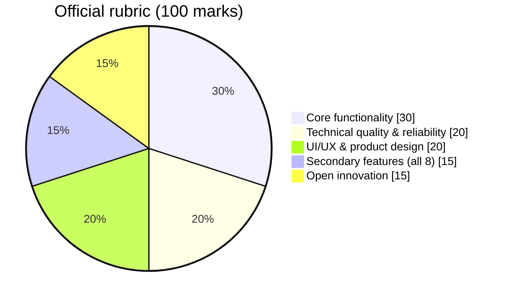
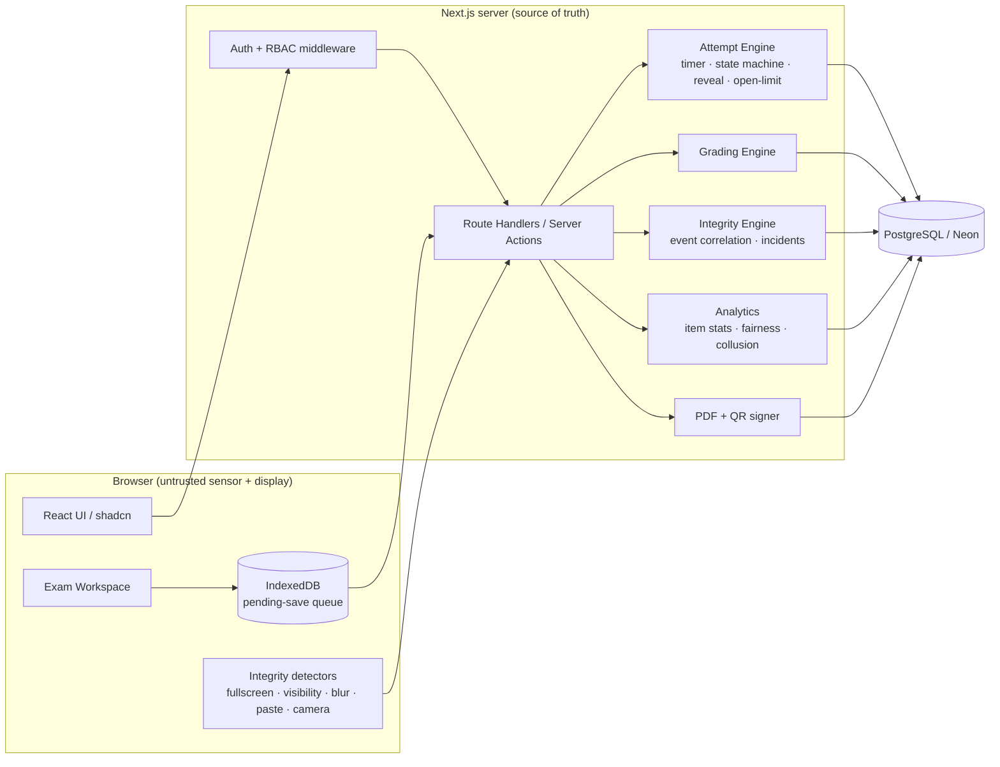
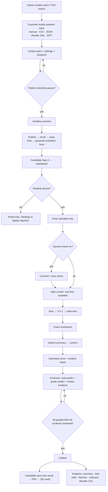
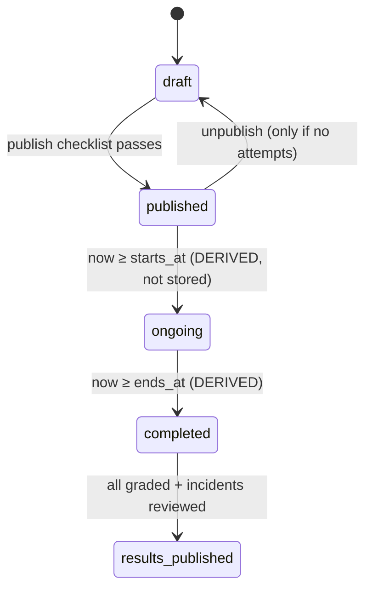
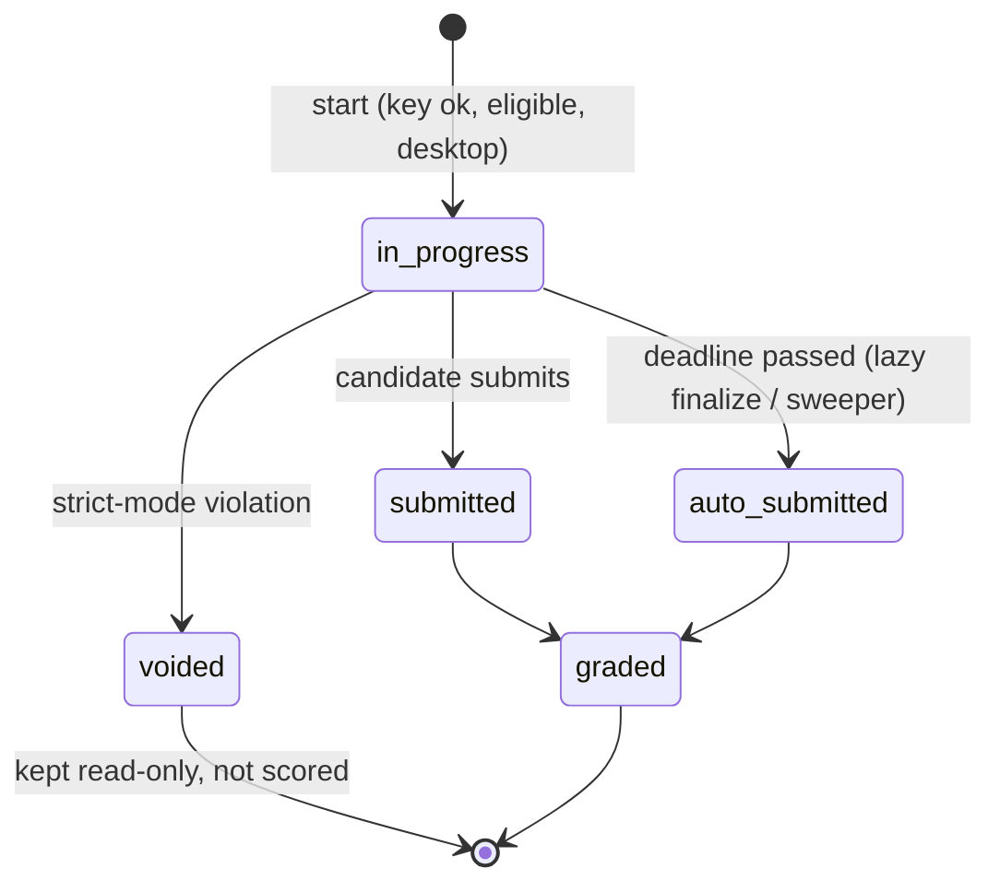
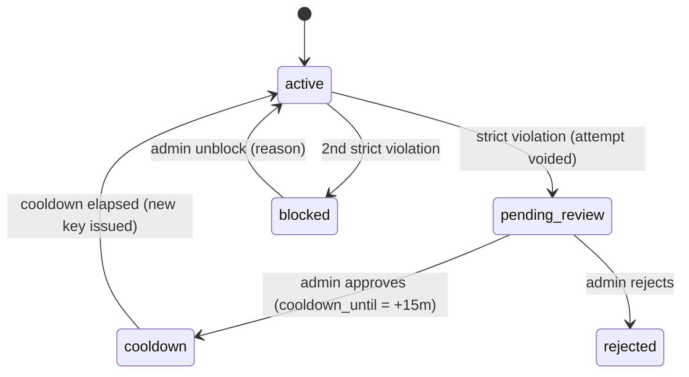
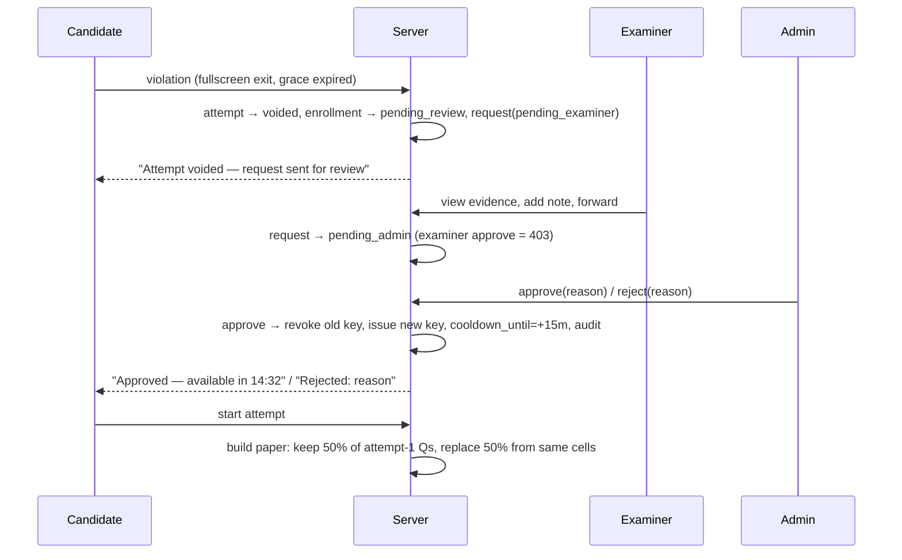
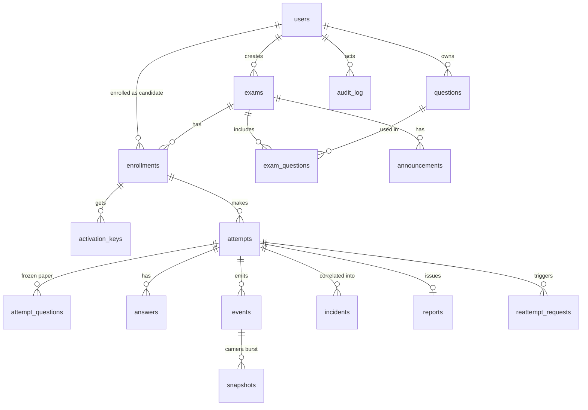
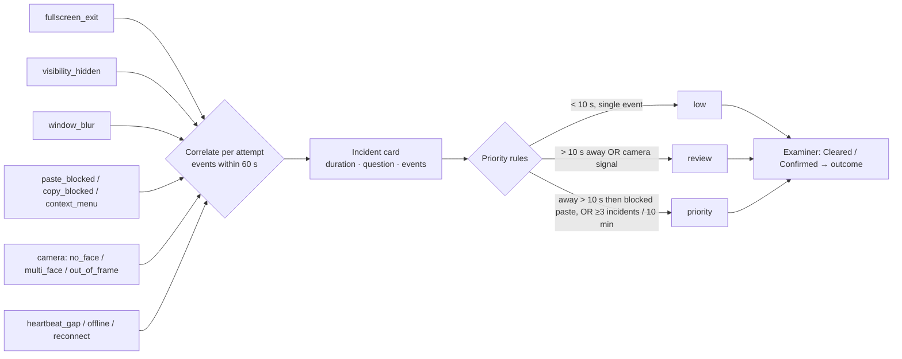

# PRD — SecureExam: Secure Examination Management System
**Technoverse 5.0 · Web-e-Thon · COMSATS Lahore · 27 Nov 2026 (build 10:00–20:00) · Evaluation 28 Nov 16:00–19:00**
**Team:** Dev A (Burhan) — Backend · Dev B — Frontend · **Status:** FINAL — this file is the single source of truth. If any other doc disagrees, this wins. Official problem statement wins over this PRD.

---

## 0. TL;DR for the coding agent
- Build a **full-stack Next.js web app** for creating, delivering, monitoring and grading online exams with **3 roles**: Admin, Examiner, Candidate.
- **The server is the only source of truth** for time, questions, answers, marks and permissions. The client is a display + signal sensor.
- Integrity is **browser-only, privacy-first, human-reviewed**: detect → warn → log → examiner decides. Nothing is penalised automatically except the declared Strict-mode rule (which still goes through human approval for re-attempts).
- **Deadline 19:40 final push. No commits/pushes/deploys after 20:00 = disqualification.**

**One-line identity (first sentence of the demo):**
> "SecureExam is an exam platform where the server owns time, questions and marks — a dropped connection costs no one a mark, every randomized paper is equally difficult, and every integrity flag is reviewed by a human, not a machine."

---

## 1. Scoring we optimise for



Rulebook also scores: requirement analysis (ambiguities resolved), validations FE+BE, backend architecture, OO/DB design, **technology selection reasons**, **mapping design → code**. Generic AI-looking UI is explicitly penalised. Placeholders get no full credit.

**Innovation challenges chosen:** **5.3 Failure-Resilient** (primary), **5.2 Fairness of Randomized Papers** (secondary), **5.1 Integrity in the AI Era** (explainable integrity engine). Depth over breadth.

---

## 2. Tech stack & reasons (judges ask "why")

| Layer | Choice | Why |
|---|---|---|
| Framework | **Next.js 15 App Router + TypeScript** | One deployable for UI + API; server components keep answer keys off the client; type safety across FE/BE |
| DB | **PostgreSQL (Neon free tier)** | Relational integrity (FKs, unique constraints, transactions, `FOR UPDATE`) is exactly what exam state needs |
| ORM | **Drizzle ORM** + drizzle-kit | SQL-close, typed, fast migrations; raw SQL when needed |
| Auth | **Auth.js (credentials)** or Better Auth, argon2/bcrypt | No paid identity provider; httpOnly session cookies |
| Validation | **Zod** shared schemas | Same rules on frontend and backend (rubric: FE+BE validation) |
| UI | **Tailwind + shadcn/ui + lucide + sonner** | Accessible primitives (Radix), fast to compose, not template-looking if themed |
| Charts | **Recharts** | Simple, SSR-safe |
| Offline queue | **Dexie (IndexedDB)** | Durable pending-save queue across refresh/outage |
| PDF / QR | **@react-pdf/renderer**, **qrcode** | Server-side PDF, no paid service |
| Import | **papaparse** + custom Moodle XML/GIFT parsers | CSV/JSON/Moodle formats |
| Camera (P2) | **@mediapipe/tasks-vision** FaceDetector (self-hosted model) | Runs on candidate device, free, no video upload |
| Realtime | **Polling 5 s** (TanStack Query refetchInterval) | Vercel serverless can't hold WebSockets; polling is reliable in a demo |
| Deploy | **Vercel + Neon** | Free, preview deploy per PR |

**Explicitly NOT used:** separate FastAPI backend, Redis, WebSockets, Safe Exam Browser, screen sharing, audio monitoring, face recognition/biometrics, paid AI APIs, encrypted offline hand-in files.

**Supported browsers:** Chrome / Edge desktop (latest). Others: banner "Best on Chrome or Edge".

---

## 3. System architecture



**Trust rule:** every client signal is *untrusted evidence*. Every rule that matters (time, eligibility, ownership, locks, limits, submissions, grading) is enforced in `src/server/**`.

---

## 4. Roles & permissions

| Capability | Admin | Examiner | Candidate |
|---|:-:|:-:|:-:|
| Manage users & roles, deactivate | ✅ | ❌ | ❌ |
| Question bank (own) | view all | ✅ | ❌ |
| Create/configure/publish exams (own) | view all | ✅ | ❌ |
| Enroll candidates, generate activation keys | ❌ | ✅ (own exams) | ❌ |
| Live monitoring, announcements, time credit | view | ✅ | ❌ |
| Review incidents (Cleared/Confirmed) | ✅ | ✅ | ❌ |
| Re-attempt requests | **approve/reject** | add note + forward (**cannot approve**) | auto-created |
| Unblock permanently blocked candidate | ✅ | ❌ | ❌ |
| Grade, regrade, publish results | ❌ | ✅ | ❌ |
| Take exams | ❌ | sandbox only | ✅ (enrolled) |
| View results | all | own exams | **own, published only** |
| Audit log | ✅ | own exams | ❌ |

Enforced on the backend via `requireRole()` + ownership checks (`exam.examiner_id = user.id`, `enrollment exists`). Hidden buttons are UX only.

---

## 5. End-to-end user flow (source of truth, 43 steps)



### Phase 0 — Setup (Admin)
1. Admin creates examiner and candidate accounts (or CSV import).
2. Admin can deactivate a user → existing sessions invalid immediately (check `users.active` on every request).

### Phase 1 — Build the exam (Examiner)
3. Question bank: single MCQ, multi-select, written; topic, difficulty (1–3), marks. Import CSV/JSON/Moodle XML/GIFT with per-row error preview; import valid rows or fix and retry.
4. Create exam: title, instructions, window `starts_at–ends_at`, duration, total marks, multi-select rule (`all_or_nothing | partial | partial_negative`), blueprint (count per topic × difficulty), `open_limit` (default 5, any number, or unlimited), `sequential_reveal` (on/off), `integrity_mode` (`standard | review | strict`, default `review`), `camera_check` (off by default).
5. Publish checklist (blocks publish): marks sum = total marks; each blueprint cell has enough questions (warn: "needs 5 hard Algebra, bank has 3"); ends_at > starts_at; duration > 0; ≥1 question.
6. Sandbox: examiner takes the exam as a candidate; `is_sandbox=true`; excluded from every stat/report/result.
7. Publish → enroll candidates → optional per-candidate extra time (multiplier 1.0–2.0) and `allow_paste` accommodation → **Generate activation keys** → print/CSV export.

### Phase 2 — Entering (Candidate)
8. Dashboard: Available / Upcoming / Completed with instructions and access status.
9. Phone/tablet: portal usable (dashboard, results, PDFs). Exam page shows **"This exam can only be taken on a desktop or laptop computer."** No Start button. "Desktop site" mode does not bypass.
10. Enter activation key (bound to this candidate, single-use; 5 wrong → locked + examiner alert).
11. If camera check on: consent screen → camera permission → face visible. Denied → cannot start (examiner may grant exception).
12. Start screen: rules + "You have **N** minutes" (= min(duration × multiplier + credit, window end − now)) → Start → 3-2-1 → fullscreen.

### Phase 3 — Taking the exam
13. Workspace: server timer, question palette, watermark (name + ID), connection chip, announcements, scratchpad, preferences (font size, theme, layout), keyboard shortcuts.
14. Per-candidate shuffled questions (within blueprint cells) and options. If `sequential_reveal`: server releases only the current question; unseen questions never reach the client.
15. Answers autosave (debounced 800 ms) and are editable. Candidate may revisit **seen** questions, never jump ahead.
16. Optional **Lock** = final (server 409 on change). **Flag** for review. Skipped can be "locked blank".
17. **Open limit:** open = seen but not locked. When open ≥ limit → next question not released → "You have 5 open questions. Lock at least one to continue." Examiner can raise the limit live (all or one candidate).
18. No paste, right-click, copy, cut, drag-drop, text selection on stems. Each blocked action logged with question number (not a violation). Exception: `allow_paste` accommodation.
19. Timer warnings at 5 min and 1 min (toast + aria-live).

### Phase 4 — Disruptions
20. Refresh / browser crash → resume with answers + server time. No key again. Re-enter fullscreen gate.
21. Internet drop → "Offline · 3 changes queued", timer keeps running server-side. On reconnect → "Synced ✓". Server records heartbeat gap; examiner sees "lost 4m12s (server-measured)" and may grant credit ≤ gap (audit-logged).
22. Device dies → log in on another **desktop**, resume.
23. Second tab/device opens the same attempt → new session takes over; old session's saves rejected (409 `SESSION_SUPERSEDED`), old tab shows "Exam continued in another window".
24. Leaves fullscreen / tab hidden / window blur → overlay "Return to the exam in 3…2…1":
    - **Standard:** log only.
    - **Review (default):** type explanation (≥10 chars) + 30 s wait → continue; examiner notified.
    - **Strict:** attempt **voided** (answers kept read-only, not scored) → re-attempt request → examiner adds note + forwards → **admin** approves/rejects with reason → if approved: 15-min cooldown → new key → new attempt with full fresh time (capped by window) and **50 % new questions** from same blueprint cells → **2nd violation = permanent block** (admin-only unblock).
25. Camera signal (no face > 5 s, ≥2 faces, face out of frame) → **warning only, exam continues** → 3-frame snapshot burst saved with question number + description.

### Phase 5 — Submit
26. Submit → summary "3 unanswered · 2 open · 1 flagged" with jump links → confirm.
27. Submitted exactly once (idempotent); at expiry auto-submit with saved answers.
28. Submission carries incident report ("Submitted · 2 incidents for review").
29. Confirmation: "Results will appear when published."

### Phase 6 — Monitoring & review (Examiner)
30. Live monitor: attempts, progress, open count, connection gaps, incidents; send announcements; handle requests; raise open limit; grant time credit.
31. Incident cards = correlated events (≤60 s window) e.g. "Left fullscreen → returned after 45 s → blocked paste 348 chars · Q7 · camera: 2 faces".
32. Review each: **Cleared** / **Confirmed** + note.
33. Confirmed outcome: `warning_only | zero_question | escalate_void` (→ admin). Never automatic deductions.

### Phase 7 — Grading & results
34. Auto-grade MCQ and multi-select per rule.
35. Manual grading of written answers (0 ≤ marks ≤ max, FE+BE), with feedback; grader sees edit timeline (char-count over time + blocked pastes).
36. **Publish blocked** until all written answers graded AND all incidents reviewed.
37. Publish. Regrade after publish requires reason → audit log → candidate notified ("Q7 regraded").
38. Candidate sees **only own published** result → PDF → QR → public verify page (masked name, exam, score, date, valid/invalid).

### Phase 8 — Analytics (Examiner)
39. Exam summary: mean, median, min, max, pass rate, distribution histogram.
40. Item stats: facility p, corrected discrimination, skipped %, most-chosen wrong option. Flags: disc < 0 **"Check answer key"** (red), disc < 0.15 low, p < 0.2 very hard, p > 0.92 too easy.
41. Fairness chart: paper difficulty spread, 500 simulated papers, naive random vs blueprint.
42. Collusion check: pairs with unusually many identical **wrong** answers → "Possible answer sharing — review". Moodle-compatible grade CSV export.

### Phase 9 — Admin oversight
43. Approve/reject re-attempts, unblock, full audit log.

---

## 6. State machines

### 6.1 Exam lifecycle

`ongoing/completed` are **derived from time** (document as a resolved ambiguity). Stored: `draft | published`, plus `results_published` boolean. After first attempt starts: questions, duration, blueprint frozen; only `ends_at` extension + announcements allowed.

### 6.2 Attempt

All transitions inside a transaction with `SELECT … FROM attempts WHERE id=$1 FOR UPDATE`.

### 6.3 Enrollment (strict mode)


### 6.4 Re-attempt approval sequence


### 6.5 Answer save path (failure-resilient)
```mermaid
sequenceDiagram
  participant W as Workspace
  participant Q as IndexedDB queue
  participant S as Server
  W->>Q: enqueue {qid, response, seq, client_ts}
  Q->>S: POST /answers (batch)
  alt online & attempt in_progress & now ≤ deadline+5s & session current
    S-->>Q: 200 {saved seq}
    Q->>Q: drop acked items (only if seq unchanged)
  else offline
    Q->>Q: keep, chip "Offline · n queued", retry backoff
  else after deadline
    S-->>Q: 409 DEADLINE_PASSED (accepted only if server logged a heartbeat gap covering the deadline AND arrival ≤ deadline+120s; flagged as incident)
  end
```

---

## 7. Data model



| Table | Key columns |
|---|---|
| users | id, name, email (unique lower), password_hash, role `admin|examiner|candidate`, active, created_at |
| user_prefs | user_id PK, prefs jsonb (font_size, theme, layout) |
| questions | id, owner_id, topic, difficulty 1–3, type `single|multi|written`, text, options jsonb `[{id,text,is_correct}]`, marks, archived, created_at |
| exams | id, examiner_id, title, instructions, starts_at, ends_at, duration_min, total_marks, status `draft|published`, results_published, settings jsonb `{multi_select_rule, blueprint:[{topic,difficulty,count}], open_limit, sequential_reveal, integrity_mode, camera_check, grace_sec:3, cooldown_min:15, shuffle_options:true}`, frozen_at |
| exam_questions | exam_id, question_id, PK(exam_id, question_id) |
| enrollments | id, exam_id, candidate_id, status `active|pending_review|cooldown|rejected|blocked`, strikes, cooldown_until, time_multiplier (1.0–2.0), allow_paste, camera_exception, open_limit_override, UNIQUE(exam_id, candidate_id) |
| activation_keys | id, enrollment_id, key_hash, hint (last 2), status `active|used|revoked|locked`, failed_tries, issued_at, used_at |
| attempts | id, enrollment_id, exam_id, candidate_id, attempt_no, is_sandbox, status `in_progress|submitted|auto_submitted|voided|graded`, started_at, deadline_at, submitted_at, active_session_id, current_index, time_credit_sec, last_heartbeat_at, score, paper_difficulty. Partial UNIQUE (enrollment_id) WHERE status='in_progress' |
| attempt_questions | attempt_id, question_id, position, option_order jsonb, marks, answer_key jsonb (server only), seen_at, locked_at — snapshot |
| answers | attempt_id, question_id, response jsonb, seq, locked, flagged, saved_at, awarded_marks, grader_id, feedback, edit_timeline jsonb. PK(attempt_id, question_id) |
| events | id, attempt_id, type, question_id, at (server), client_at, duration_ms, meta jsonb, incident_id |
| incidents | id, attempt_id, started_at, ended_at, duration_sec, priority `low|review|priority`, summary, review_status `unreviewed|cleared|confirmed`, outcome `warning_only|zero_question|escalate_void`, reviewer_id, note |
| snapshots | id, event_id, attempt_id, seq 1–3, image bytea, taken_at (max 20 bursts/attempt) |
| reattempt_requests | id, attempt_id, enrollment_id, status `pending_examiner|pending_admin|approved|rejected`, examiner_note, admin_id, admin_reason, created_at, decided_at |
| announcements | id, exam_id, target_candidate_id null, message, created_at |
| reports | id, attempt_id unique, verify_code unique, hmac, issued_at |
| audit_log | id, actor_id, action, entity, entity_id, before jsonb, after jsonb, reason, at |

Indexes on every FK column. Timestamps `timestamptz` UTC.

---

## 8. Core business rules (BR) — enforced server-side

| ID | Rule |
|---|---|
| BR-01 | Every route: `requireUser()` (active) + `requireRole()` + ownership/enrollment check. |
| BR-02 | `deadline_at = min(started_at + duration×time_multiplier + time_credit, exam.ends_at)`. Client timer = `deadline_at − server_now` (server sends `server_now` every response). |
| BR-03 | Start requires: published, now ∈ window, enrolled, enrollment `active`, not cooldown, valid key, desktop check, no other in_progress attempt. |
| BR-04 | Paper snapshot on start: blueprint draw (seeded crypto-random) → attempt_questions with option order + marks + key. Bank edits never affect active attempts. |
| BR-05 | Answer keys never serialised to candidate responses (dedicated DTOs). |
| BR-06 | Save accepted only if attempt `in_progress`, session current, not locked, now ≤ deadline + 5 s (see 6.5 exception). Higher `seq` wins. |
| BR-07 | Sequential reveal: next question released only if `open_count < open_limit` (override if set). |
| BR-08 | Submit: `UPDATE attempts SET status='submitted' … WHERE id=$1 AND status='in_progress'` in `FOR UPDATE` tx → idempotent. |
| BR-09 | Lazy finalize: any read/write of an expired in_progress attempt auto-submits first; plus `/api/cron/finalize` sweeper. |
| BR-10 | Strict violation → void + request; examiner cannot approve (403); admin decides; 2nd violation → blocked. |
| BR-11 | Re-attempt paper: keep 50 % of prior questions, replace 50 % from same topic×difficulty cell; warn at publish if cells too small. |
| BR-12 | Results publish blocked until every written answer graded and every incident reviewed. |
| BR-13 | Candidate results: `candidate_id = me AND results_published`. |
| BR-14 | Sandbox excluded from all stats, results, reports, collusion. |
| BR-15 | Multi-select: all_or_nothing = full if exact set; partial = marks × correct_chosen/total_correct, 0 if any wrong; partial_negative = marks × (correct − wrong)/total_correct, floored at 0. |
| BR-16 | Manual marks: 0 ≤ marks ≤ question marks, 2 decimals; regrade after publish requires reason. |
| BR-17 | Activation key: hash stored, bound to enrollment, single-use, 5 failed → locked + event. |
| BR-18 | Desktop-only start/resume: client deviceCheck true AND `Sec-CH-UA-Mobile` ≠ `?1` AND UA not mobile → else 403 `DESKTOP_REQUIRED`. |
| BR-19 | Time credit ≤ server-measured heartbeat gap, ≤ 25 % of duration, examiner only, audit-logged. |
| BR-20 | Questions used in any attempt cannot be deleted → archived. Exam settings frozen after first attempt (only ends_at extension). |
| BR-21 | Monitoring signals are never conclusive; UI wording "signals for review". |

---

## 9. Integrity engine (5.1)



- **Prevention (client):** fullscreen required, questions hidden outside fullscreen, block contextmenu/copy/cut/paste/drop/`beforeinput insertFromPaste|insertFromDrop`, `user-select:none` on stems, `beforeunload` warning, watermark.
- **Detection:** events above + `navigator.sendBeacon` on `pagehide`; every event stores `question_id`.
- **Mitigation:** per-candidate shuffle, sequential reveal, open limit, watermark, blueprint equivalence.
- **Evidence:** correlated incidents, snapshots, edit timeline, collusion pairs, audit log.
- **No numeric "cheating score". No auto deductions.**
- Camera (P2): MediaPipe every 1.5 s; debounce one event per signal per 20 s; 3 frames 320×240 JPEG q0.5; stop tracks on submit.
- Phones in "desktop mode" detection: `matchMedia('(pointer: coarse)')`, `screen.width < 1024`, iPadOS (`maxTouchPoints > 1` + Macintosh UA), `navigator.userAgentData?.mobile`.

**Honest limits (say in demo):** a web app cannot see other apps, second devices or OS overlays (e.g. Cluely); client blocks can be bypassed with DevTools. Server rules + human-reviewed evidence are the real enforcement; full OS lockdown would need Safe Exam Browser (future work).

---

## 10. Fairness (5.2) & resilience (5.3)

**Fairness:** exam blueprint = counts per (topic × difficulty). Each paper draws randomly *within* cells → variation preserved, difficulty equal. After attempts exist, use observed facility p instead of authored difficulty. `paper_difficulty` = mean expected facility of drawn items. Fairness chart = histogram/box of paper_difficulty for 500 simulated papers: naive random vs blueprint.

**Resilience:** server-owned deadline; IndexedDB pending queue with seq; heartbeat every 15 s; server-measured gaps; examiner-granted capped credit; session takeover; resume on any desktop; lazy finalize; idempotent submit. No self-granted time is ever possible.

---

## 11. Secondary features checklist (all 8 expected)

| # | Feature | Implementation | Owner |
|---|---|---|---|
| 4.1 | Network-aware UI | connection chip: Saved ✓ / Saving… / Offline · n queued / Synced; red banner if save fails > 30 s | B (A: heartbeat API) |
| 4.2 | PDF reports | `/api/reports/:attemptId/pdf` (candidate own + published; examiner own exam) and exam summary PDF | A (B: buttons) |
| 4.3 | Sandbox | `is_sandbox` attempts, banner "Sandbox — not recorded" | A + B |
| 4.4 | Bulk import | CSV/JSON/Moodle XML/GIFT, preview table with row errors | A parser, B UI |
| 4.5 | Question analytics | item stats + flags | A queries, B charts |
| 4.6 | Verifiable reports | verify_code + HMAC, QR → `/verify/:code` (public, masked) | A + B |
| 4.7 | Custom workspace | font size, theme, layout (list/single/split), persisted in user_prefs | B (A: prefs API) |
| 4.8 | Scratchpad | canvas pen/eraser + text notes per attempt (local + optional save) | B |

---

## 12. API contract (Dev A owns, Dev B consumes)
Contracts live in `src/lib/contracts/*.ts` as Zod schemas + inferred types. **Write these first (Sprint 0).** All responses `{ data } | { error: { code, message, fieldErrors? } }`, plus `serverNow` on attempt endpoints.

| Method & path | Role | Purpose |
|---|---|---|
| POST /api/auth/* | all | Auth.js |
| GET/POST/PATCH /api/admin/users | admin | list/create/update/deactivate |
| POST /api/admin/users/import | admin | CSV |
| GET/POST/PATCH/DELETE /api/questions | examiner | bank CRUD (delete → archive if used) |
| POST /api/questions/import | examiner | csv/json/moodle-xml/gift → {valid[], errors[]} ; ?commit=true |
| GET/POST/PATCH /api/exams | examiner | CRUD + settings |
| GET /api/exams/:id/checklist | examiner | publish checklist |
| POST /api/exams/:id/publish · /unpublish | examiner | |
| POST /api/exams/:id/enrollments | examiner | add/import candidates, extra time, accommodations |
| POST /api/exams/:id/keys | examiner | generate/reissue keys → plaintext once |
| GET /api/candidate/exams | candidate | dashboard buckets |
| POST /api/exams/:id/attempts | candidate/examiner(sandbox) | start {key, deviceCheck} |
| GET /api/attempts/:id | owner | state, deadline, serverNow, palette, open count |
| GET /api/attempts/:id/questions/current · /:position | owner | question DTO (no key); 403 if unseen in sequential mode |
| POST /api/attempts/:id/next | owner | release next (BR-07) |
| PUT /api/attempts/:id/answers | owner | batch save [{qid, response, seq}] |
| POST /api/attempts/:id/answers/:qid/lock · /flag | owner | |
| POST /api/attempts/:id/heartbeat | owner | {sessionId} → serverNow, announcements |
| POST /api/attempts/:id/events | owner | integrity events (beacon-compatible) |
| POST /api/attempts/:id/explanation | owner | review-mode explanation |
| POST /api/attempts/:id/violation | owner | strict-mode → void |
| POST /api/attempts/:id/submit | owner | idempotent |
| GET /api/exams/:id/monitor | examiner | live attempts, incidents, gaps |
| POST /api/exams/:id/announcements | examiner | |
| POST /api/attempts/:id/time-credit · /open-limit | examiner | |
| PATCH /api/incidents/:id | examiner/admin | review + outcome |
| GET/PATCH /api/requests | examiner (note/forward) · admin (decide) | re-attempts |
| POST /api/admin/enrollments/:id/unblock | admin | |
| GET /api/exams/:id/grading · PATCH /api/answers/:attemptId/:qid/grade | examiner | |
| POST /api/exams/:id/results/publish · /regrade | examiner | BR-12, BR-16 |
| GET /api/candidate/results | candidate | own published |
| GET /api/reports/:attemptId/pdf · /api/exams/:id/report/pdf | scoped | |
| GET /api/verify/:code | public | masked |
| GET /api/exams/:id/analytics · /items · /fairness · /collusion · /export/moodle.csv | examiner | |
| GET /api/audit | admin | |
| GET/PUT /api/me/prefs | any | |
| GET /api/cron/finalize | system | sweeper |

---

## 13. Pages (Dev B owns)

| Route | Role | Notes |
|---|---|---|
| /login | all | |
| /admin · /admin/users · /admin/requests · /admin/audit | admin | |
| /examiner · /examiner/questions · /examiner/questions/import | examiner | |
| /examiner/exams/new · /examiner/exams/[id] (tabs: Settings, Questions, Blueprint, Candidates & Keys, Monitor, Grading, Results, Analytics) | examiner | |
| /candidate · /candidate/exams/[id] (start/gates) · /candidate/exams/[id]/attempt · /candidate/results | candidate | |
| /verify/[code] | public | |

**Design rules (20 marks):** one accent colour, one display font (next/font), neutral greys, 8 px spacing grid, no purple gradients/emoji headers. Every async action has loading/success/error. Empty states with next action. Keyboard: 1–4 select option, N/P next/prev, L lock, F flag. Visible focus rings, aria-live for timer + save status, WCAG AA contrast. Split pane (question left, answer right) on desktop. Responsive portal on mobile.

---

## 14. Edge-case test matrix (judges will try these)

| ID | Scenario | Expected | Owner |
|---|---|---|---|
| T01 | Candidate opens another candidate's result URL / API | 403, logged | A |
| T02 | Examiner opens another examiner's exam | 403 | A |
| T03 | Start before window / after window | blocked with message | A |
| T04 | Not enrolled / wrong key ×5 | blocked / key locked + alert | A |
| T05 | Late starter | start screen shows reduced time | A+B |
| T06 | Change OS clock | no effect on timer | A+B |
| T07 | Refresh mid-exam | same answers, time, position | A+B |
| T08 | Close browser, return after deadline | already auto-submitted | A |
| T09 | Double-click submit / refresh during submit | exactly one submission | A |
| T10 | Network offline in DevTools | queue chip, syncs on reconnect | B+A |
| T11 | Second tab | takeover, old tab read-only | A+B |
| T12 | Edit question during active attempt | active attempt unchanged | A |
| T13 | Lock then change answer | 409, UI shows locked | A+B |
| T14 | 5 open questions | next blocked with message; examiner raises limit → continues | A+B |
| T15 | Unseen question requested in sequential mode | 403 | A |
| T16 | Answer key in network payload | absent | A |
| T17 | Paste / right-click / drag | blocked + logged | B |
| T18 | Phone + "Desktop site" | portal OK, exam blocked | B+A |
| T19 | Esc in review mode | explanation + 30 s, continue | B+A |
| T20 | Esc in strict mode | void → request → examiner can't approve → admin approves → cooldown → new key → 50 % new Qs | A+B |
| T21 | 2nd strict violation | permanent block, admin unblock only | A |
| T22 | Camera: cover face / second person | warning only + snapshot burst in incident | B+A |
| T23 | Publish with ungraded written / unreviewed incident | blocked, shows counts | A |
| T24 | Manual mark > max | rejected FE+BE | A+B |
| T25 | Multi-select 3 rules | correct scores | A |
| T26 | CSV with bad rows | row errors, import valid only | A+B |
| T27 | Tampered verify code | "Not valid" | A |
| T28 | Sandbox attempt | excluded from analytics | A |
| T29 | Deactivated user mid-session | next request 401 | A |
| T30 | Blueprint cell too small | publish warning | A |

---

## 15. Seed data (`pnpm db:seed`)
- 1 admin, 2 examiners, 40 candidates (fictional), test credentials in README.
- 60 questions across 4 topics × 3 difficulties × 3 types.
- Exam A "Midterm — completed": 30 graded attempts, results published, **one question seeded with a wrong answer key** (shows red flag), **one colluding pair** (shared wrong answers), varied incidents (cleared + confirmed), one voided attempt + approved request.
- Exam B "Live now": window open now → 2 h, keys generated, strict mode, camera off.
- Exam C "Upcoming": tomorrow.
- Exam D "Practice": standard mode.

---

## 16. Team split, sprints & points

**Dev A (Burhan) — Backend:** `db/**`, `src/server/**`, `src/app/api/**`, `src/lib/contracts/**`, seed, auth/RBAC, engines, analytics, PDF/QR, import parsers, README backend sections.
**Dev B — Frontend:** `src/app/(portal)/**` pages, `src/components/**`, `src/hooks/**`, design system, exam workspace, client detectors, IndexedDB queue, camera module, charts, scratchpad, prefs.
**Shared:** `src/lib/contracts/**` (A owns; B requests changes via PR comment). B builds against **mock fixtures** (`src/mocks/**`) from contracts until A's endpoints land.

```mermaid
gantt
  title Sprint plan (27 Nov)
  dateFormat HH:mm
  axisFormat %H:%M
  section Dev A Backend
  S0 Scaffold, schema, auth, contracts, deploy   :a0, 12:00, 45m
  S1 Exams, bank, enroll, keys, start, save, submit :a1, after a0, 120m
  S2 Grading, publish, results, monitor, events, incidents :a2, after a1, 105m
  S3 Strict flow, requests, analytics, PDF/QR, import :a3, after a2, 105m
  S4 Fix, seed polish, README                     :a4, after a3, 60m
  section Dev B Frontend
  S0 Design system, layout, login, mocks          :b0, 12:00, 45m
  S1 Examiner exam builder + candidate workspace  :b1, after b0, 120m
  S2 Grading UI, results, monitor, detectors, offline chip :b2, after b1, 105m
  S3 Strict/review overlays, analytics charts, scratchpad, prefs, camera :b3, after b2, 105m
  S4 UX polish, a11y, backup video                :b4, after b3, 60m
  section Gates
  Steel thread works end-to-end                   :milestone, m1, 14:45, 0m
  Feature freeze                                  :milestone, m2, 18:15, 0m
  FINAL PUSH                                      :milestone, m3, 19:40, 0m
```



### Sprint backlog with points (1 pt ≈ 15 min)

**S0 · 12:00–12:45 — Foundation (both)**
| Task | Owner | Pts |
|---|---|---|
| Next.js + TS + Tailwind + shadcn init, repo, branch protection, Vercel+Neon connected, empty deploy | A | 1 |
| Drizzle schema (§7) + migration + seed skeleton | A | 1 |
| Auth.js credentials, `requireUser/requireRole`, role redirects | A | 1 |
| Zod contracts for exams, attempts, answers, questions | A | 1 (shared) |
| Theme tokens, font, AppShell (sidebar/topbar per role), login page | B | 2 |
| Mock fixtures from contracts | B | 1 |

**S1 · 12:45–14:45 — Steel thread** (exam → take → submit)
| Task | Owner | Pts |
|---|---|---|
| Question bank CRUD API + archive rule | A | 1 |
| Exam CRUD + settings + blueprint + checklist + publish | A | 2 |
| Enrollment + activation keys | A | 1 |
| Start attempt: BR-02/03/04, paper snapshot, seeded shuffle | A | 2 |
| Attempt GET, current/next question, BR-07 open limit | A | 1 |
| Batch save, lock, flag, submit (BR-06/08), lazy finalize | A | 1 |
| Question bank UI + editor | B | 2 |
| Exam builder (settings, questions, blueprint, candidates & keys) | B | 2 |
| Candidate dashboard + start gates (device, key, start screen, fullscreen) | B | 1 |
| Exam workspace: timer, palette, question view, autosave, lock/flag, open-limit message, submit summary | B | 3 |

**S2 · 14:45–16:30 — Grade, publish, monitor**
| Task | Owner | Pts |
|---|---|---|
| Auto-grade (BR-15) + manual grade API + publish gate (BR-12) + regrade | A | 2 |
| Candidate results API + PDF + verify code + /verify | A | 2 |
| Heartbeat, events (beacon), correlation → incidents, monitor API, announcements, time credit | A | 3 |
| Grading UI, results publish UI, candidate results page | B | 2 |
| Monitor dashboard (attempts, incident cards, announce, credit, raise limit) | B | 2 |
| Client detectors (fullscreen/visibility/blur/paste/contextmenu/drag), IndexedDB queue, connection chip, second-tab handling | B | 3 |

**S3 · 16:30–18:15 — Integrity, analytics, secondary**
| Task | Owner | Pts |
|---|---|---|
| Strict flow: violation → void → requests (examiner forward / admin decide) → cooldown → new key → 50 % new paper → block/unblock | A | 3 |
| Analytics: summary, item stats + flags, fairness simulation, collusion, Moodle CSV | A | 2 |
| Import parsers CSV/JSON/Moodle XML/GIFT + preview | A | 1 |
| Sandbox, prefs API, audit log API, admin users API | A | 1 |
| Review/strict overlays, request status screens, admin requests page | B | 2 |
| Analytics charts (histogram, item table, fairness chart, collusion list) | B | 2 |
| Import UI, scratchpad, workspace prefs, watermark, sandbox banner | B | 2 |
| P2 camera check (only if all above green) | B | 2 |

**S4 · 18:15–19:15 — Harden & polish** — run §14 matrix (both), UX pass, README, test credentials, record 60 s backup video, rehearse demo.
**S5 · 19:15–19:40 — Freeze** — merge last PRs, verify production URL, tag `v1.0`, **final push 19:40**, then set Vercel *Ignored Build Step* to `exit 0` and stop pushing.

---

## 17. Git & pull-request workflow
- `main` = production (Vercel). Protected: PR required, 1 approval (the other dev), no force-push.
- Branches: `be/<topic>` (Dev A), `fe/<topic>` (Dev B), e.g. `be/attempt-engine`, `fe/exam-workspace`.
- **Small PRs every 45–60 min.** Rebase on `main` before opening. Each PR has a Vercel preview — reviewer clicks through it.
- Merge with **"Create a merge commit"** (keep commit history visible to judges — do not squash everything into one).
- Conventional commits: `feat(api): …`, `fix(workspace): …`, `chore(db): …`. Never amend dates, never force-push `main`.
- Contract changes: only Dev A edits `src/lib/contracts/**`; Dev B comments in PR.
- Conflicts: owner of the folder resolves.
- Migrations: only Dev A creates migrations; Dev B never edits `db/**`.

---

## 18. AI-assisted development (encouraged — use agents heavily)
Allowed by the rules. Each dev runs their own coding agent (Claude Code / Cursor / Codex) **scoped to their folders**.

**Setup (each machine, verify commands once):**
```bash
# Skills (Claude Code / any agent that reads .claude/skills)
npx -y skills add anthropics/skills --skill frontend-design --agent claude-code     # Dev B
npx -y skills add anthropics/skills --skill webapp-testing --agent claude-code      # both (Playwright tests)
npx -y skills add jezweb/claude-skills --skill shadcn-ui --agent claude-code         # Dev B
# MCP servers
npx shadcn@latest mcp init --client claude                                          # Dev B
claude mcp add playwright -- npx @playwright/mcp@latest                             # both
claude mcp add context7 -- npx -y @upstash/context7-mcp                             # both (current docs)
```
- Cursor reads `AGENTS.md` and `.cursor/rules/*.mdc`; Claude Code reads `CLAUDE.md`. Both point to this PRD.
- `.cursorignore` keeps secrets, build output and large files out of AI context.
- **Prompt pattern:** "Implement PRD §X (rules BR-..). Only touch <folders>. Write Zod contract first, then route, then a Playwright/Vitest test for T-ids. Do not change other modules."
- Agent must **never** commit `.env*`, never run destructive DB commands on production, never push to `main` directly.
- Ask the agent to run `pnpm lint && pnpm typecheck && pnpm test` before every PR.

---

## 19. README must contain
Setup steps · env vars list (no values) · test credentials per role · architecture diagram (§3) · tech choices (§2) · **requirement ambiguities & resolutions** (§20) · innovation challenges implemented (5.1/5.2/5.3) · "Try to break it" checklist (§14) · honest limitations.

## 20. Requirement ambiguities resolved (rubric: case study analysis)
1. Multi-select marking unspecified → configurable 3 rules (BR-15).
2. "Ongoing" state → derived from time, not manual.
3. Window vs duration → deadline = min(start + duration, window end); shown before start.
4. Randomization vs fairness → blueprint sampling (5.2).
5. Monitoring "not conclusive" → incidents reviewed by humans; no auto deductions.
6. Lock-down impossible in browser → layered prevention + detection + evidence, stated openly.
7. Re-attempts unspecified → Strict mode policy with examiner→admin approval and fresh paper.
8. Editing exams after start → frozen except ends_at extension.
9. Offline at deadline → server-measured gap rule (6.5), examiner-granted capped credit.

## 21. Demo script (15 min)
1. 0:00 One-line identity + who it's for.
2. Examiner: blueprint exam → checklist → sandbox → publish → keys.
3. Candidate: key → start screen → fullscreen → answer, lock, hit open limit → refresh (persists) → DevTools offline → reconnect synced.
4. Press Esc (review mode) → explanation. Switch to strict exam → void → examiner forwards → admin approves → new key.
5. Security: other result URL → 403; network tab shows no keys; double submit → one.
6. Monitor: incident card with timeline (+ camera burst if built) → Cleared.
7. Grade written → publish → PDF → scan QR → verify.
8. Analytics: red "check answer key" item, fairness chart, collusion pair.
9. Limits + "what breaks first at scale" (polling → SSE/queue; Postgres connection pooling).

## 22. Definition of done
Feature works on deployed URL · FE + BE validation · server-side auth check · loading/error/empty states · keyboard accessible · no console errors · covered by a T-id check · merged via PR.

## 24. AMENDMENTS — 27 Nov 14:20 (override earlier sections where they conflict)

### 24.1 Authentication — keep Auth.js credentials; Google sign-in is optional
- Do NOT migrate to a hosted auth provider now (working auth + time risk). Keep Auth.js credentials + dev account buttons.
- P2 optional: Auth.js Google provider (free Google Cloud OAuth client, no billing). Google sign-in only logs in users who already exist or match an allowed domain — it never creates exam access by itself.

### 24.2 Account access model — institution-controlled, no public self-signup
- Single institution per deployment. Table `org_settings` (singleton): `name`, `allowed_domains text[]` (e.g. `umt.edu.pk`), `allow_external_invites bool`.
- **No open sign-up.** Accounts come from: (a) admin create / CSV import, (b) examiner enrolling candidates by email (creates candidate account if missing, sends nothing — shows temp password / key list), (c) Google sign-in auto-creates a CANDIDATE account only if email domain ∈ allowed_domains.
- **External users** (e.g. gmail.com): only by explicit invite — admin or examiner adds the email; `users.is_external = true`; badge "External" in lists. Gmail domain is never auto-allowed.
- Role upgrades (candidate → examiner) only by admin. Audit-logged.
- Pitch: "Self-signup is disabled on purpose — an exam platform must know who its candidates are."

### 24.3 Exam creation wizard + sections + per-exam question upload
**Wizard (Dev B UI, Dev A presets API)** — `/examiner/exams/new` multi-step:
1. **Type:** Quiz · Midterm · Final · Assignment · Practice. Each applies presets (editable later):

| Type | Duration | Integrity | Open limit | Camera | Sequential | Results |
|---|---|---|---|---|---|---|
| Practice | 20 min | standard | unlimited | off | off | instant after submit |
| Quiz | 30 min | review | 10 | off | off | manual publish |
| Assignment | 120 min | review | unlimited | off | off | manual publish |
| Midterm | 90 min | strict | 5 | optional | on | manual publish |
| Final | 180 min | strict | 5 | on | on | manual publish |

2. **Basics:** title, course/subject, instructions, window, total marks.
3. **Sections:** add sections (e.g. "A — MCQs", "B — Written"). Each section: title, instructions, allowed question types, marks per question, shuffle on/off, and a **question source**:
   - **Pick from bank** (filter by course/topic/difficulty/type) → manual selection or blueprint counts per topic×difficulty;
   - **Create new** inline;
   - **Upload file** (CSV/JSON/Moodle XML/GIFT) **into this section** → same preview/error flow; uploaded questions are saved to the bank tagged with the course and linked to this section.
4. **Integrity & delivery settings** (pre-filled by type).
5. **Review & checklist** → Save draft / Publish.
- Questions can be added to a section later (upload or pick) while the exam is draft or published-before-first-attempt (BR-20 still freezes after first attempt).

**Data model changes (Dev A):**
- `exams.exam_type` (`practice|quiz|assignment|midterm|final`), `exams.course`.
- `questions.course` (text), `questions.tags text[]`.
- New `exam_sections(id, exam_id, title, instructions, position, allowed_types text[], shuffle bool, blueprint jsonb, marks_per_question numeric null)`.
- `exam_questions` gets `section_id` (FK) + `position`.
- `attempt_questions` gets `section_id`; shuffle happens **within each section**; sections appear in order.
- Publish checklist: every section has ≥1 question; section marks sum = exam total marks; blueprint cells satisfiable.
- Question bank page: filter by course + tags + "used in exams".

**New/changed API:** `GET /api/exam-presets`, `POST/PATCH/DELETE /api/exams/:id/sections`, `POST /api/exams/:id/sections/:sid/questions` (attach from bank), `POST /api/exams/:id/sections/:sid/import` (upload → preview/commit), `PATCH /api/exams/:id/sections/reorder`.
**Workspace:** palette grouped by section headers; section instructions shown when entering a section.

## 23. Out of scope (do not build)
Safe Exam Browser integration, screen sharing, audio monitoring, face recognition/biometric identity, numeric cheating scores, encrypted offline hand-in files/QR answer transfer, extra roles, webhooks, dual-marker grading, LTI 1.3, Odoo, separate backend service, Redis, WebSockets. Don't quote unverified statistics in the pitch.
